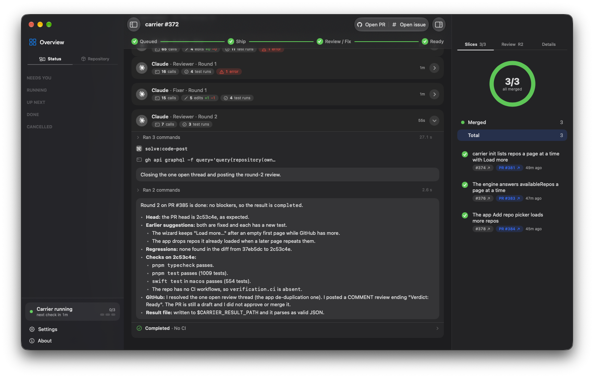

<h1 align="center">Carrier</h1>

<p align="center">
  An autonomous epic orchestrator that runs on your machine.<br />
  It watches your GitHub repos for epics marked ready, has one AI agent implement them with <code>ship</code>, has a second agent with a different identity review the final PR, and hands you an epic that is ready to test.
</p>

<p align="center">
  
  
  
  
  
  
  
  
  
</p>

<p align="center">
  
</p>

> **Status:** first version, macOS only, built for personal use. Agents run as the regular `claude`, `codex` and `agy` CLIs with **your permissions** and no isolation. Read [Security](#security) before pointing it at anything you care about.

## What it does

Carrier is a long-running process: a terminal app, or in the background with `carrier start`. You start it from any folder with a JSON config; it polls the repos you list and, for every epic labelled `solve:epic:ready`, drives the whole loop without supervision:

1. **Pick up.** Each interval it registers new ready epics in arrival order, and when a slot is free it takes the oldest one and relabels it `solve:epic:running`.
2. **Ship.** An _author_ agent (Claude Code, Codex or Antigravity) runs [Solve](https://github.com/AshuLab/skills)'s `ship` on the epic inside a managed clone. Carrier then checks the final integration PR against GitHub: it exists, is open, references the epic, and its head is the expected commit.
3. **Review.** A _reviewer_ agent with a **different GitHub identity** reviews that PR in a separate checkout. If it asks for changes, the author gets a fix turn and the reviewer goes again, up to `maxReviews` rounds.
4. **Hand-off.** The epic ends as `solve:epic:ready-for-test` (a conclusive review on the current head) or `solve:epic:needs-human` (stopped, with the reason shown in the terminal). Carrier never merges the final PR — you test it and decide.

It is built to survive interruptions: SQLite is the source of truth and labels are its mirror, technical failures are retried by a new execution that first verifies the real state (no duplicate PRs, comments or commits), `Ctrl+C` stops the agents but keeps sessions and work, and a restart reconciles against GitHub before continuing.

## What's included

- **Setup** — `carrier init` (guided, or all flags) writes the config; `carrier doctor` checks it and the machine; `carrier schema` prints the config's JSON Schema.
- **Run without a terminal** — `carrier start --config <path>` launches Carrier as a detached run (its own session, its output in `<root>/orchestrator/logs/start.log`) and returns once the control socket answers, within 15 seconds; on a root where Carrier already runs it says so, does nothing and exits 0, and if it does not come up it prints the end of the log and exits 1. `carrier stop`, `pause`, `resume` and `check` do from any terminal what the panel's `Ctrl+C`, `p` and `r` do (`check` looks at GitHub now) and confirm in one line: exit 0 on success (`stop` also when none runs), 1 when no Carrier runs (or answers), 2 when it speaks another protocol. See [ADR 0010](docs/adr/0010-carrier-runs-in-the-background-as-a-detached-process.md).
- **Status** — `carrier status` prints the panel of the running Carrier once, from any terminal; exit 0 it runs, 1 it is not running, 2 it speaks another protocol. `carrier watch` attaches the live panel to it with the same keys as the foreground one, except `q` (and `Ctrl+C`) only leave: Carrier keeps running. It exits 1 when none runs or when the Carrier it watches stops. Both show each epic's stage history (running, needing you, or ready for test), asked over the socket; a Carrier that does not list `sessions` in its hello is drawn from the snapshot alone, and an epic whose request fails is drawn without it.
- **Restart a stopped epic** — `carrier restart <owner/name>#<issue> [--author <option>] [--reviewer <option>]` resumes an epic in needs-human from the terminal (the `resumeEpic` request of the socket), on the agent option of each role you choose. In a terminal and without flags it asks for each role, with the current option preselected and the role that failed marked; without a terminal it keeps the current options. The same option continues the agent's session with `--resume`; another one starts a new session in the epic's worktree and pull request, rebuilt from SQLite and GitHub like a lost session. It prints one line and exits 0; a refusal prints the engine's reason and exits 1 (so does no Carrier running), a malformed argument or another protocol exits 2. It needs an engine that lists `agentOptions` in its hello.
- **Chat host** — `carrier chat --workspace <folder> [--agent <name>]` opens a conversation (it prints the answer as it streams; `/quit` leaves and the session stays open), `carrier chat --list [--archived]`, `--archive`, `--unarchive` and `--delete <id>` (deleting leaves nothing of the session; a working one is refused) talk to the chat host, a process of its own under `<root>/chat/` (socket `chat.sock`, `chat.db`, `logs/`), and starts it detached when none answers; it ends by itself a minute after the last client leaves, or at once with `carrier chat --stop`. The engine and the host run side by side and neither's stop touches the other. `carrier chat-host --config <path>` runs it in the foreground. See [ADR 0013](docs/adr/0013-the-chat-host-is-its-own-process-with-an-adapter-per-provider.md) and [the spec](docs/specs/chat-host.md).
- **Config** — a user JSON file merged over defaults, validated with Zod at startup with one error per field; per-repo overrides for identity, agent option and persona; under separate identities (the default) author and reviewer must resolve to different profiles.
- **Polling and queue** — FIFO across repos with pagination, rate-limit and outage handling; one instance per root folder (an exclusive SQLite lock released by the OS on death).
- **Scheduler** — atomic reservation, configurable concurrency, label management (`running`, `ready-for-test`, `needs-human` are created in each repo if missing).
- **Stages** — ship, review and fix loops with a typed caller result (`completed`, `changes_requested`, `needs_human`) imported idempotently in a single transaction.
- **Failure handling** — execution retries with session resume, per-execution timeouts (or `unlimited`), Forge authentication errors that stop only the affected profile, repos removed from config, and a stop rule when the final PR is merged or the epic is closed.
- **Agent runners** — real adapters for the Claude, Codex and Antigravity (`agy`) CLIs (cloud models, or local ones from LM Studio or Ollama through Claude and Codex) as child processes (session id, resume, output capture, stop, orphan detection), with per-execution credentials and the bot's git identity.
- **Workspaces** — managed clones under a shared root, and a separate detached checkout for the reviewer.
- **Terminal panel** — a dependency-free ANSI dashboard: uptime, repos watched and the next check, slots, a card per running epic (stage chain, review round, blockers, time in stage, last activity, links, errors), the queue, epics that need you and the ones ready for test, a hint when it is idle, and below it the epics that ended inside the finished window: DONE (merged) and CANCELLED (closed without a merge, with the stored reason), ten each and a `+N more` line; plain lines when there is no TTY. On a terminal it reads keys; a row is always selected (highlighted), each running card shows a `now` line of what its agent is doing (three lines when selected), and the footer lists only the keys that apply: `↑`/`↓` (or `j`/`k`) select, `enter` opens the PR or issue, `l` shows the agent's output, `r` checks GitHub now, `p` pauses or resumes taking new epics, `?` lists them, `q` quits like `Ctrl+C` (stops Carrier; in `watch` it only leaves).
- **Logging** — [`@ashulab/universal-logger`](https://github.com/AshuLab/universal-logger) to files, with token redaction, and 30-day retention of logs and sessions.
- **Tests** — unit tests with fakes and a temp SQLite; gated integration tests with real tools.

## Tech stack

| Layer | Technology |
|-------|-----------|
| Runtime | Node.js 22+ for the package (compiled to `dist/`); 26 to work on it, where TypeScript runs via native type stripping. ESM |
| Language | TypeScript (strict) |
| State | SQLite via `better-sqlite3`, schema and migrations with Drizzle ORM + Drizzle Kit |
| Validation | Zod (config, caller result, GitHub responses) |
| Logging | `@ashulab/universal-logger` |
| GitHub access | `gh` CLI, authenticated per profile through Agent Forge (GitHub Apps) |
| Identities | [Agent Forge](https://github.com/AshuLab/agent-forge) bot profiles, or your own `gh` login |
| Agents | Claude Code, Codex and Antigravity (`agy`) CLIs, headless; their models from the cloud or from LM Studio / Ollama |
| Workflow | [Solve](https://github.com/AshuLab/skills) skills (`ship`, `code-review`, ...) |
| Terminal UI | `@clack/prompts` for `init` and `doctor`; plain ANSI escape sequences for the panel |
| Testing | Vitest (unit and gated integration) |
| Package manager | pnpm 12 |

## Repository structure

```text
carrier/
├── src/
│   ├── terminal/       # everything a terminal user sees; a web UI would be a sibling of this folder
│   │   ├── cli/        #   the command line: args, commands/ (run, start, stop/pause/resume/check, status, watch, init, doctor, schema), the control-socket client, config file, composition root, Ctrl+C
│   │   ├── prompts/    #   the terminal contract (`Ui`) and its clack implementation: prompts, spinners, check lines
│   │   ├── wizard/     #   `carrier init`: the flow, what it asks (questions/), what it needs from the machine (deps), the recap
│   │   └── dashboard/  #   the panel: renderers (dashboard, plain), keys and their state, agent-output tail, each epic's stage history
│   ├── status/         # what Carrier is doing right now, read from SQLite (the view any front-end draws)
│   ├── control/        # the control socket: snapshot, pause/resume, check, stop, sessions, events, epic, files, availableRepos (a page at a time), resumeEpic
│   ├── doctor/         # the checks of `carrier doctor` and the remedy for each failure
│   ├── config/         # config schema, defaults, loading/merging, per-repo resolution, JSON Schema, default path
│   ├── orchestration/  # engine: polling, scheduler, stages, retries, restart, final-PR rules, ports + fakes
│   ├── execution/      # AgentRunner/Workspaces ports, caller result parsing and idempotent import
│   ├── harnesses/      # Claude, Codex and Antigravity runners, credentials, local providers, orphan detection
│   ├── integrations/   # GitHub through Agent Forge (`gh` via execFile)
│   ├── prompts/        # author and reviewer prompts (what the agents are told, not terminal prompts)
│   ├── storage/        # SQLite schema, migrations, lock, executions, events, retention
│   ├── logging/        # universal-logger integration
│   └── format/         # duration formatting
├── macos/              # the native app: a client of the control socket (see its README)
└── docs/
    ├── specs/          # the specs the features were built from
    ├── adr/            # architecture decision records
    ├── research/       # spike findings
    └── glossary.md     # domain vocabulary
```

## Getting started

### 1. Prerequisites

- macOS and Node.js 22 or newer. Working from a clone needs Node.js 26 and pnpm 12.
- `git` and the GitHub CLI (`gh`).
- At least one of the `claude`, `codex` and `agy` (Antigravity) CLIs, installed and logged in from the terminal where you run Carrier. For local models, LM Studio or Ollama running.
- Two different GitHub identities, one per role: [Agent Forge](https://github.com/AshuLab/agent-forge) bot profiles, or your own `gh` login for one of them. Or, if you cannot get a second one, a **shared identity**: your `gh` login for both roles (`carrier init` offers it, or `--identities shared`). Both roles then act with everything that login's token can do.
- The target repos use the [Solve](https://github.com/AshuLab/skills) flow.

### 2. Install

```bash
pnpm add -g @ashulab/carrier
```

Or run it without installing: `pnpm dlx @ashulab/carrier`. To work on Carrier itself, clone the repo and run `pnpm install`.

### 3. Create the config

```bash
carrier init
```

It looks at the machine (stopping with the fix if `git`, `gh` or every agent CLI is missing, and listing the models your local servers have), asks for the repos to watch (picked from the repos your `gh` login can push to, grouped by owner), whether the author and the reviewer use separate identities or one shared identity (your `gh` login for both, after a note that both act with everything its token can do; it never reads Agent Forge), the identity of each role under separate identities, then an **Agent options** section before the roles, where you add agent options one at a time (the CLI among the installed ones, the local provider when a server is running, the model and, for Claude and Codex, the config folder: the `~/.claude`, `~/.claude-*` and `~/.codex` it finds with their login state, the environment, or a typed path; Antigravity has no folder), each with a suggested name that must be a lowercase word and unique, and after each one whether to add another; each role then asks one question, which of those options runs it, and with two or more options it asks whether to turn failover on and in which order (the `failover` block). Run again on an existing config it keeps the options and the `failover` block and lets you add more (editing or removing one is done in the file). Then the persona of each role (a name and a prompt, each skippable, and when editing `-` clears one; `--author-persona-name`, `--author-persona-prompt`, `--reviewer-persona-name` and `--reviewer-persona-prompt` answer them), writes the config to `~/.carrier/config.json` (one global file per user; change it with `--out`) and runs the checks below. Run again on an existing config, it offers to edit it with its answers as the starting points. Before saving it shows a recap to confirm, and the checks that follow print only what fails (otherwise a single count), then it shows how many epics are waiting and offers to start Carrier. If there is no second GitHub identity it can run `agent-forge add` for you on the spot. Every question has a flag (`carrier init --help`); `--author` and `--reviewer` (`<harness>:<model>`, with `--author-provider` and `--reviewer-provider`) each declare one option named after its harness and skip the section and the failover question when both are given. `--yes` never asks, so an agent can run it too (`--identities shared --yes` takes the `gh` login for both roles and prints the note; it cannot go with `--author-profile` or `--reviewer-profile`):

```bash
carrier init --yes --repo AshuLab/my-repo \
  --author-profile forge:<agent-1> --author claude:<model> \
  --reviewer-profile forge:<agent-2> --reviewer codex:<model>
```

Without `--author` and `--reviewer`, `--yes` writes one `claude` option that runs both roles; the flags above give each role its own option.

Check a config (yours or a hand-written one) at any time:

```bash
carrier doctor
```

It verifies the tools are installed, that the author and the reviewer really are different identities (under separate identities), that each identity can get a token for each repo, and that the orchestrator can read it. `carrier schema` prints the JSON Schema of the config for your editor.

#### The file, by hand

A JSON file merged over the defaults (objects merge by field, simple values replace, lists replace entirely). Invalid configs print every error with its field and exit without starting anything.

```json
{
  "repos": [{ "name": "AshuLab/my-repo", "agents": { "reviewer": { "option": "claude" } } }],
  "profiles": {
    "author-bot": { "kind": "forge", "agent": "<forge-agent-1>" },
    "reviewer-bot": { "kind": "forge", "agent": "<forge-agent-2>" }
  },
  "orchestratorProfile": "author-bot",
  "agentOptions": {
    "claude": { "harness": "claude", "model": "<model>" },
    "codex": { "harness": "codex", "model": "<model>" }
  },
  "agents": {
    "author": { "profile": "author-bot", "option": "claude" },
    "reviewer": { "profile": "reviewer-bot", "option": "codex" }
  }
}
```

Defaults: `root` `~/.solve`, `pollIntervalMinutes` 5, `logLevel` `info`, and `limits` of `maxConcurrentEpics` 3, `maxReviews` 5, `maxExecutionRetries` 3, `maxExecutionHours` 4 (or `"unlimited"`), `githubCallTimeoutSeconds` 30. Identity, agent option and persona for author and reviewer can be overridden per repo; an agent option (`agentOptions`) is a harness, model, optional provider and optional config folder. The file holds no secrets: a profile is `{ "kind": "forge", "agent": ... }` or `{ "kind": "gh" }`.

### 4. Run it

```bash
carrier
```

`carrier` reads `~/.carrier/config.json`; pass `--config <path>` to use another file. It holds the terminal and runs until `Ctrl+C`; to leave it running with the terminal closed, use `carrier start` instead (see [What's included](#whats-included)). Only one instance can run per root folder. From a clone, run `pnpm build` and then `node dist/terminal/cli/main.js`, or `node src/terminal/cli/main.ts --config ...` (Node 26 runs the TypeScript directly).

Mark an epic `solve:epic:ready` in a configured repo and watch the panel.

## Scripts

| Command | What it does |
|---------|--------------|
| `pnpm build` | Compile to `dist/` (what gets published) |
| `pnpm typecheck` | Type-check the project |
| `pnpm test` | Full unit suite — fakes and a temp SQLite, no network and no real agents |
| `pnpm test:integration` | Integration tests with real tools; they skip with a clear message unless their environment variables are set |
| `pnpm db:generate` | Generate a Drizzle migration after changing the schema |

The gated tests use `CARRIER_IT_*` and `CARRIER_TEST_*` variables; each test file lists the ones it needs in its header.

## Where it keeps things

The config is `~/.carrier/config.json` (override the folder with `CARRIER_HOME`). Everything else is under `root` (default `~/.solve/`), shared with Solve:

- `repos/<org>/<repo>/` — managed clones.
- `worktrees/<repo>/<feature>/` — workspaces created by Solve; `reviews/<repo>/<epic>/` — the reviewer's separate checkout.
- `orchestrator/` — `carrier.db` (SQLite), `logs/orchestrator.log` and `logs/executions/<id>/` with each agent's full output. Logs and sessions of a finished or cancelled epic are deleted after 30 days; SQLite and workspaces are never touched.

## Security

Unattended agents run with **your** permissions: Claude with permissions bypassed, Codex with `--dangerously-bypass-approvals-and-sandbox` and Antigravity with `--dangerously-skip-permissions` (a model served locally changes nothing about this), so they can touch files, credentials and other repos on the machine. Carrier adds no isolation in this version ([ADR 0004](docs/adr/0004-agents-run-on-host-with-terminal-preferences.md)); run it on a machine or user account where you accept that. Each execution's GitHub token has the minimum scopes of its role, and your repos should have branch protection. Without a container, stopping an agent does not guarantee that its child processes die. Hardening unattended agents is planned follow-up work.

## Documentation

- Using it: [configuration](docs/configuration.md), [preparing a repo](docs/preparing-a-repo.md) and [troubleshooting](docs/troubleshooting.md).
- [Specs](docs/specs/) (the orchestrator's is [autonomous-orchestrator](docs/specs/autonomous-orchestrator.md)), [glossary](docs/glossary.md) and the [macOS app](macos/README.md).
- [ADRs](docs/adr/) — coordination vs. evaluation, SQLite as the authority, agents on the host (which replaces the container ADR 0003), the engine independent of the macOS app, and Carrier running detached on demand, not as a login service.
- [Research](docs/research/) — headless agents, Antigravity, Agent Forge, logging and panel, shared root, containers (dropped, kept as reference).
- [`AGENTS.md`](AGENTS.md) — entry point for coding agents working in this repo.

## License

[MIT](LICENSE)
