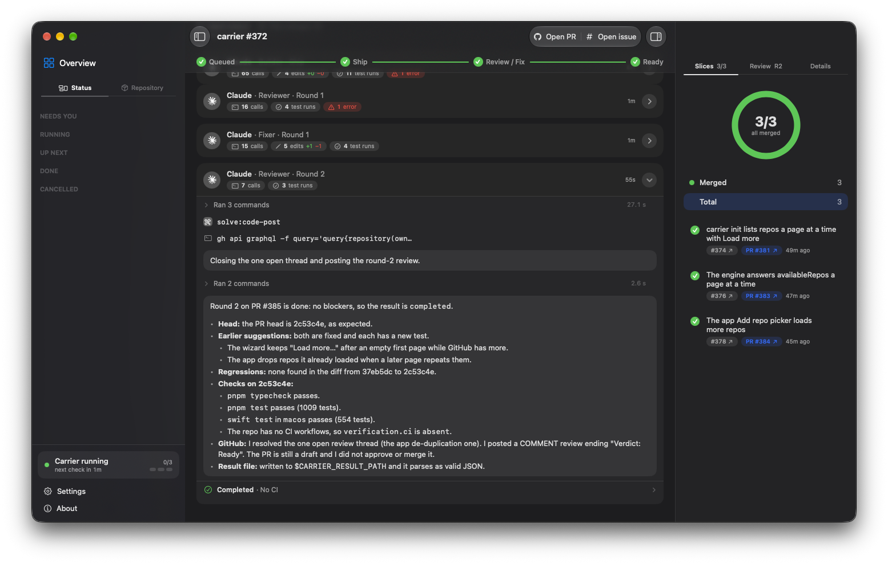

<h1 align="center">Carrier</h1>

<p align="center">
  An autonomous epic orchestrator that runs on your machine.<br />
  Mark an epic as ready on GitHub. One AI agent builds it, a second one reviews it, and you get an epic ready to test.
</p>

<p align="center">
  
  
  
</p>

<p align="center">
  
</p>

> **Status:** first version, macOS only, built for personal use. Agents run as the regular `claude`, `codex` and `agy` CLIs with **your permissions** and no isolation. Read [Security](#security) before pointing it at anything you care about.

## Install

You need a Mac with [Homebrew](https://brew.sh).

```bash
brew install ashulab/tap/carrier          # the `carrier` command
brew install --cask ashulab/tap/carrier   # the Mac app (optional, Apple Silicon, macOS 26+)
```

Before you use it you also need:

- At least one agent CLI (`claude`, `codex` or `agy`), installed and logged in.
- A GitHub identity for the author and another for the reviewer: [Agent Forge](https://github.com/AshuLab/agent-forge) bots, or your own `gh` login.
- Target repos that use the [Solve](https://github.com/AshuLab/skills) flow ([how to prepare one](docs/preparing-a-repo.md)).

More options (no Homebrew, upgrade, uninstall): [install](docs/install.md).

## First run

```bash
carrier init      # guided setup: repos, agents, identities. Writes ~/.carrier/config.json
carrier doctor    # checks the config and the machine, and tells you how to fix what fails
carrier           # starts Carrier and shows the live panel (Ctrl+C stops it)
```

Then add the label `solve:epic:ready` to an epic in one of your repos and watch the panel. Prefer the Mac app? Open it: it finds `carrier` by itself.

## How it works

Carrier polls the repos you list and, for every epic labelled `solve:epic:ready`, runs the whole loop without supervision:

1. **Pick up.** It takes the oldest ready epic when a slot is free and relabels it `solve:epic:running`.
2. **Ship.** An _author_ agent (Claude Code, Codex or Antigravity) runs [Solve](https://github.com/AshuLab/skills)'s `ship` on the epic in a managed clone, and Carrier checks the final PR on GitHub.
3. **Review.** A _reviewer_ agent with a **different GitHub identity** reviews that PR. If it asks for changes, the author fixes and the reviewer goes again, up to `maxReviews` rounds.
4. **Hand-off.** The epic ends as `solve:epic:ready-for-test` or `solve:epic:needs-human` (with the reason shown). Carrier never merges the final PR: you test it and decide.

It survives interruptions: state lives in SQLite, retries first check the real state on GitHub (no duplicate PRs or comments), and a restart picks up where it left. More in [what the engine does](docs/cli.md#what-the-engine-does).

## Everyday commands

| Command | What it does |
|---------|--------------|
| `carrier start` | Run in the background; `stop`, `pause`, `resume` and `check` control it from any terminal |
| `carrier status` / `carrier watch` | Show what the running Carrier is doing, once or live |
| `carrier restart <owner/name>#<issue>` | Resume an epic that stopped in `needs-human` |
| `carrier chat --workspace <folder>` | Talk to an agent in a session |

All the commands and their options: [command line](docs/cli.md).

## Security

Unattended agents run with **your** permissions: Claude with permissions bypassed, Codex with `--dangerously-bypass-approvals-and-sandbox` and Antigravity with `--dangerously-skip-permissions` (a model served locally changes nothing about this), so they can touch files, credentials and other repos on the machine. Carrier adds no isolation in this version ([ADR 0004](docs/adr/0004-agents-run-on-host-with-terminal-preferences.md)); run it on a machine or user account where you accept that. Each execution's GitHub token has the minimum scopes of its role, and your repos should have branch protection. Without a container, stopping an agent does not guarantee that its child processes die. Hardening unattended agents is planned follow-up work.

## Documentation

- **Using it:** [install](docs/install.md) · [command line](docs/cli.md) · [configuration](docs/configuration.md) · [preparing a repo](docs/preparing-a-repo.md) · [troubleshooting](docs/troubleshooting.md) · [macOS app](macos/README.md)
- **Understanding it:** [glossary](docs/glossary.md) · [specs](docs/specs/) (start with [autonomous-orchestrator](docs/specs/autonomous-orchestrator.md)) · [ADRs](docs/adr/) · [research](docs/research/)
- **Contributing:** [`CONTRIBUTING.md`](CONTRIBUTING.md) (setup, tech stack, repo structure) · [`AGENTS.md`](AGENTS.md) (entry point for coding agents) · [changelog](CHANGELOG.md)

## License

[MIT](LICENSE)
