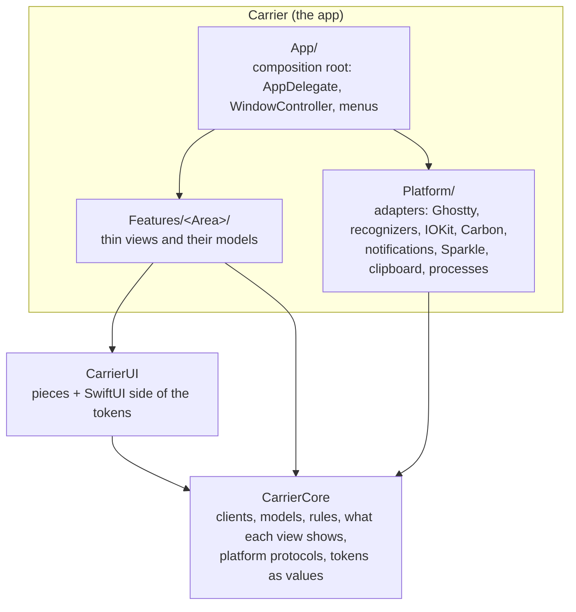
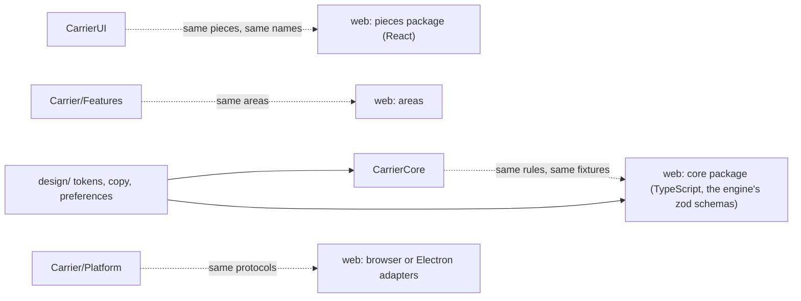

# The macOS app today, and where each file goes

The evidence behind [the reorganization of the macOS app](../specs/macos-app-as-the-base-for-a-web-front-end.md): what `macos/Sources` holds at `main` 3ce1aa4e3 (2026-11-24), counted by script, and a first map of every file to its folder in the new tree ([0052](../adr/design/0052-the-macos-app-is-split-into-three-targets-by-layer-and-each-target-by-area.md)).
The map was made from the file names and what each file declares, then corrected by hand where a name misled.
It is a draft: the ticket that moves an area checks each of its files against it, and a file that belongs elsewhere moves there and the map is corrected.

## Today in numbers

| What | Count | Where |
| --- | --- | --- |
| Swift files | 363 | `Carrier/` 170, `CarrierCore/` 193, each one flat folder |
| Lines | about 63,400 | `Carrier/` about 33,000, `CarrierCore/` about 30,500 |
| Files over 400 lines | 34 | listed below |
| Views (`struct ...: View`) | 108 files | `Carrier/` |
| AppKit bridges (`NSView`, `NSViewRepresentable`, `NSWindowController`) | 23 files | `Carrier/` |
| `@Observable` types | 41 | 22 in `Carrier/`, 19 in `CarrierCore/` |
| `@State` | 334 | `Carrier/` |
| Preference reads and writes | 208 `@AppStorage`, 49 `UserDefaults` | 56 files |
| Literal radii, paddings and colours in views | 156 `cornerRadius:`, 65 `.padding(n)`, 37 `Color(red:)` | `Carrier/` |
| Literal texts in views | 254 `Text("...")` | `Carrier/`, plus the sentences `CarrierCore` builds |
| Localization | none | no `defaultLocalization`, no catalog |
| Refusals in words | 200 `new ChatRefused(...)` | `src/chat/` and `src/usage/` |
| Config writes from the app | 9 files | listed below |
| Tests | 176 files in `CarrierCoreTests`, 43 in `CarrierTests`, 42 fixtures | `macos/Tests/` |

## The layers



A dependency only points down.
`CarrierUI` takes from `CarrierCore` only the design tokens, never a domain type.
`Platform/` implements protocols that `CarrierCore` declares, so `Features/` asks for "a recognizer" or "keep awake", never for WhisperKit or IOKit.

A web front-end copies the same layers:



## The tree, folder by folder

```
macos/Sources/
  CarrierCore/
    Connection/   the clients of the two sockets and how often they ask: EngineLink, ControlClient, ControlMonitor, ChatHost, ChatLink, Snapshot, PollPace, IdleClose
    Lifecycle/    starting, replacing and upgrading the engine and the host: StartCarrier, StartChatHost, EngineReplacement, HostReplacement, EngineIdentity, CarrierUpgrade, StartingSteps
    Shell/        the window, the menus and the icon as values: WindowShell, MenuSessions, IconState, AppIcon, Shortcuts, Viewing
    Sessions/     the sidebar, the sessions home, the archive, a new session: Sidebar, Sessions, SessionSections, NewSession, SessionAges, ...
    Chat/         a conversation and what it shows: ChatConversation, TranscriptItems, ChatToolGroups, Replies, Attachments, ...
    Epics/        an epic, its slices, its review: EpicPoller, EpicView, SliceCard, FindingsCard, Lanes, ReviewTab, InspectorTabs, ...
    Projects/     projects and their worktrees: ProjectsFile (until 0053 replaces its writes), ProjectsList, ProjectWorktrees, ...
    Terminal/     TerminalCore, TerminalSplitTree, TerminalPersistence, TerminalSettings, ...
    Dictation/    DictationSession, GlobalDictation, DictationRecords, DictationStatistics, ModelStore, ...
    Usage/        UsageModels, UsageConsumption, UsagePage, UsageStore, ...
    KeepAwake/    KeepAwake
    Updates/      UpdateFlow, UpdateDelay
    Health/       Health, HealthRows, DoctorChecks, SetupDetection, ...
    Settings/     the window's pages as values, one subfolder for each page that is Carrier's config: Agents/, Watching/, Behavior/, Providers/, Engine/; the rest (SettingsIndex, SettingsHistory, SettingsPage, AppPreferences) at its top
    Platform/     only protocols: Recognizer, Microphone, KeepAwakeAssertion, Notifier, Updater, GlobalShortcut, Clipboard, ProcessRunner
    Theme/        the design tokens as values (generated) and what reads them: Theme, TypeScale, MonospaceSettings, IconSets, FileIcons, ProviderIcons
    Copy/         the copy keys (generated) and the language
    Support/      helpers with no domain: TimeText, JSONMessage, CarrierPlaces, InlinePath, ShellQuote, Signposts, StepLog, ResourceBundle
    Fixtures/     what `--fixture` runs: FixtureServer, FixtureRecognizer, ScriptedDictation, ConversationSample
  CarrierUI/    (starts as Carrier/UI/, becomes this target in the last step; see 0052)
    Tokens/       Color, Font and spacing from the tokens: AppTheme, ScaledFont, PieceTheme, SidebarMetrics, WorkColors
    Buttons/      PrimaryCapsuleButtonStyle, SecondaryCapsuleButtonStyle, ToolbarPillButton, IconButton, HoverFillButtonStyle, HoverTextButtonStyle, NoticeActionStyle, CheckButton, ...
    Fields/       NumberField, the settings field modifier, ToolbarSearchField, SidebarSearchField
    Selects/      SelectMenu, SelectChevron, SelectButtonStyle, SegmentedChoice, ChoicePopUp
    Rows/         SettingsTabRow, SettingsStackedRow, NavigationRow, HoverRow, SidebarSectionRow, MonoLines
    Cards/        NoticeCard, SettingsTabCard, SettingsGroup, OverviewTitle, OverviewCard, OverviewLinkRow, WorkCard, HoverCard, CardFactsGrid, CodeBlockView
    Chips/        StatusChip, PullRequestChip, Badge, ChosenMark
    Meters/       QuotaBar, QuotaPercent, SegmentedProgress, Ring, WorkingRing, SpinningRing
    Feedback/     EmptyStateView, LoadingStateView, ProblemLine, BannerView, Shimmer, GlowEdge
    Layout/       FlowLayout, EqualWidthRow, UnderlineTabs, SettingsPageBody
    Modifiers/    MiddleClickModifier, the anchored and preference keys of Settings, WindowSheetSize, RowState
    Icons/        Glyph, IconImages, StateGlyph, Disc, StateMark, StatusMark, AccountMark, ProviderMark, BrandLogo, ProjectIcon, CardChevron
  Carrier/
    App/          main, AppDelegate, WindowController, MainMenu, MenuControls, StatusMenuGroups, StatusHeaderView, StatusHeaderState, SessionMenu, EpicMenuSection, KeepAwakeMenu, LaunchPhases, EngineIdentityStore, AppHealth, TimeFormatChanges
    Features/
      Lifecycle/  StartController, StartingView, RunningView, StoppedView, ChatHostStarter
      Sessions/   SidebarView, SidebarTab, SessionRowView, SessionSectionsView, SessionsHomeView, NewSessionView, WhereItWorksSheet, ArchiveView, ...
      Chat/       ConversationView, ChatTab, TranscriptView, ChatToolGroupView, MessageBox, ComposerMenuButton, ModelPicker, CommandStyle, CodeBlockRuns, ...
      Epics/      PanelView, EpicView, ReviewTabView, SlicesTabView, SliceCardView, FindingsCardView, InspectorTabsView, ...
      Projects/   ProjectsTab, ProjectDetailView, AddProjectSheet, BranchSheet, CleanupGroup, CleanupController, ...
      Terminal/   TerminalWorkspaceView, TerminalTabView, TerminalTabBarView, TerminalsHomeView, ...
      Dictation/  DictationWidget, DictationController, GlobalDictationController, DictationTab and its groups (History, Statistics, Recognition, Sounds, Storage, SpeechModels), ...
      Usage/      UsageView, UsageConsumptionView, ContextUsageButton, QuotaMeter
      KeepAwake/  KeepAwakeTab
      Updates/    UpdatePill
      Health/     HealthTab, HealthFixButton, SetupController, CheckAgainButton
      Settings/   SettingsWindow, SettingsSidebar, SettingsPages, General, Appearance, Notifications, Keybindings, About, NoticesGalleryView; Agents/, Watching/, Behavior/, Providers/, Engine/
    Platform/     TerminalHost, CarrierTerminalView, TerminalAppearance, TerminalProcessInspector, CommandTextView, AppleRecognizer, FluidAudioRecognizer, WhisperKitRecognizer, MicrophoneCapture, CaptureConverter, DictationSoundPlayer, KeepAwakeController, GlobalHotKey, FocusedField, ClipboardPaste, SystemNotificationCentre, AppUpdater, IconController, MetricsSink, ProcessRun, BrewRunner, ShellDetector, ProgramVersions
macos/Tests/
  CarrierCoreTests/<the same folders as CarrierCore>/
  CarrierTests/<the same folders as Carrier>/
  Fixtures/
design/
  tokens.json, preferences.json, copy/en.json, copy/es.json
scripts/
  design.ts      generates CarrierCore/Theme, CarrierCore/Copy, the app's Localizable.xcstrings and the preferences' declarations; `--check` fails when they differ
```

Two rules decide where a file goes when its name does not:

- A page of Settings that changes one app area lives in that area (the Dictation, Terminal, Sessions, Projects and Keep awake pages); a page that is Carrier's config, or the app as a whole, lives under `Settings/` (Agents, Watching, Behavior, Providers, Engine, General, Appearance, Notifications, Keybindings, About).
- Only `Platform/` imports Ghostty, FluidAudio, WhisperKit, Speech, AVFoundation, IOKit, Carbon, ApplicationServices, UserNotifications, Sparkle, MetricKit or ServiceManagement; a file that needs one of them and also draws is split in two.

## Every file, by its new folder

Lines in brackets; the order within a folder is by size.
Under `CarrierUI`, the files hold whole pieces today; the pieces hidden in screens are in the next section.

- `Carrier/App` [13 files, 2,314 lines]: WindowController (652), AppDelegate (440), MainMenu (366), StatusMenuGroups (195), SessionMenu (173), MenuControls (144), EpicMenuSection (84), KeepAwakeMenu (78), AppHealth (55), StatusHeaderView (55), LaunchPhases (38), EngineIdentityStore (24), main (10).
- `Carrier/Features/Lifecycle` [5]: StartController (214), ChatHostStarter (203), RunningView (96), StoppedView (66), StartingView (50).
- `Carrier/Features/Sessions` [12]: SidebarView (617), SessionRowView (542), SessionSectionsView (386), SessionsHomeView (323), NewSessionView (268), SessionsTab (207), ArchiveView (196), SessionsSidebarView (184), ArchiveSection (122), SessionPullRequestChip (102), WhereItWorksSheet (71), SessionPlacePill (43).
- `Carrier/Features/Chat` [20]: ConversationView (721), TranscriptView (661), ChatToolGroupView (653), MessageBox (416), ModelPicker (366), ComposerMenuButton (347), ChatQuestionView (199), AttachmentChip (145), JSONMessageView (123), ChatApprovalView (97), ConversationTimeline (88), SubagentRowView (85), AudioPlayerView (82), SessionPeekView (81), SubagentView (80), AttachmentPreview (66), SubagentHeaderView (66), AgentSwitchDivider (48), ContextCutDivider (41), ChatSurface (33).
- `Carrier/Features/Epics` [15]: PanelView (523), EpicView (323), ReviewTabView (263), FilesChangedView (244), FindingsCardView (195), SlicesTabView (171), PreparationStepsView (166), SliceCardView (156), DetailsTabView (126), EpicCardView (72), ResumeCardView (57), YourTurnView (53), InspectorTabsView (40), QueuedPlanView (34), UpNextView (29).
- `Carrier/Features/Projects` [5]: ProjectsTab (1,148, split: `ProjectDetailView` with its Worktrees and Start extensions, `ProjectIdentityParts`, `ProjectActionsView`, `DiskBar`), AddProjectSheet (636, split: `AddProjectNew`, `AddProjectResults`, `AddProjectGithub`), BranchSheet (260), CleanupGroup (169), CleanupController (60).
- `Carrier/Features/Terminal` [7]: TerminalWorkspaceView (814), TerminalTabView (511), TerminalTabBarView (420), TerminalsHomeView (188), TerminalSidebarView (186), TerminalConfirmationCopy (181), ContinueInTerminalView (56).
- `Carrier/Features/Dictation` [17]: DictationWidget (501), DictationController (371), GlobalDictationGroup (311), HistoryGroup (237), StatisticsGroup (219), SpeechModelsTable (162), DictationTab (142), GlobalDictationController (122), DictationIndicator (102), DictationStatusCard (95), PastedTextCard (74), DictationButton (64), RecognitionGroups (54), SpeechModelsGroup (43), DictationFixtures (41), SoundsGroup (34), StorageGroup (16).
- `Carrier/Features/Usage` [3]: UsageConsumptionView (503), UsageView (308), ContextUsageButton (129).
- `Carrier/Features/KeepAwake` [1]: KeepAwakeTab (82).
- `Carrier/Features/Updates` [1]: UpdatePill (106).
- `Carrier/Features/Health` [3]: HealthTab (127), SetupController (82), HealthFixButton (37).
- `Carrier/Features/Settings` [5]: SettingsTabs (1,494, split: its pieces to `CarrierUI`, General, Appearance (with `ThemeGallery`, `AccentSwatches`) and Notifications (`NotificationsTabView`, the name `NotificationsTab` is `CarrierCore`'s) to `Settings/`, the toolbar's state to `SettingsToolbarState`, the Sidebar page to `Sessions/SidebarTab`, the Chat page to `Chat/ChatTab`), SettingsWindow (582, split: `SettingsSidebar`, `SettingsPages`, `EngineParts`), AboutTab (144), NoticesGalleryView (127), KeybindingsTab (119).
- `Carrier/Features/Settings/Agents` [4]: AgentsTab (392), AgentsParts (228), RoleAvatar (132), CreateBotRow (26).
- `Carrier/Features/Settings/Watching` [6]: WatchingTab (277), WatchingListScreen (172), WatchingRole (123), WatchingRepoScreen (91), WatchedReposView (68), WatchingBanner (36).
- `Carrier/Features/Settings/Behavior` [1]: BehaviorTab (276, split: its button styles and `NumberField` to `CarrierUI`).
- `Carrier/Features/Settings/Providers` [2]: ProvidersTab (553, split: `ProvidersTextGenerators`, `ProvidersParts`), ProvidersEditor (300).
- `Carrier/Platform` [23]: TerminalHost (1,013), CommandTextView (528), FluidAudioRecognizer (273), KeepAwakeController (262), TerminalProcessInspector (258), AppUpdater (199), IconController (194), WhisperKitRecognizer (183), SystemNotificationCentre (143), AppleRecognizer (139), TerminalAppearance (127), MicrophoneCapture (82), CarrierTerminalView (81), GlobalHotKey (75), FocusedField (74), ClipboardPaste (69), ShellDetector (49), BrewRunner (44), CaptureConverter (35), ProgramVersions (32), MetricsSink (28), ProcessRun (27), DictationSoundPlayer (15).
- `CarrierUI` [27]: CodeBlockView (234), Icons (229), SpinningRing (208), ScaledFont (158), ToolbarPillButton (156), NoticeCard (147), HoverCard (146), CheckButton (134), MiddleClickModifier (125), EmptyStateView (113), SheetParts (96), AppTheme (95), StateGlyph (82), OverviewParts (80), AccountMark (79), SidebarSearch (74), CardFactsGrid (56), BrandLogo (51), UnderlineTabs (50), LookingTimeline (46), FlowLayout (44), MonoLines (41), RowParts (31), RollingTitle (25), WorkCard (20), CommandStyle (14), TimeFormatChanges (13). The parts files (`SheetParts`, `OverviewParts`, `RowParts`) are split into one file per piece (`SheetParts` and `RowParts` are, in the pieces' slice of the Sessions and Chat screens).
- `CarrierCore/Connection` [9]: ChatHost (969), ChatLink (296), ControlClient (254), Snapshot (221), EngineLink (137), ControlMonitor (126), PollPace (125), ControlRequests (76), IdleClose (36).
- `CarrierCore/Lifecycle` [8]: StartCarrier (124), CarrierBox (77), CarrierUpgrade (73), EngineReplacement (71), HostReplacement (69), StartChatHost (48), EngineIdentity (47), StartingSteps (37).
- `CarrierCore/Shell` [6]: WindowShell (231), Shortcuts (177), AppIcon (152), IconState (86), Viewing (68), MenuSessions (10).
- `CarrierCore/Sessions` [9]: NewSession (863), SessionSections (607), Sidebar (345), Sessions (330), SessionAges (95), SessionsHome (95), EmptyStates (75), SessionSeen (44), SelectionHistory (38).
- `CarrierCore/Chat` [18]: ChatConversation (1,414), ChatToolGroups (479), ChatArchive (397), Replies (274), CodeHighlight (252), TranscriptItems (251), ChatOptions (208), Attachments (176), ModelPicker (144), SubagentView (144), ChatCommands (119), ChatSessions (106), Commands (66), ComposerMenu (63), SessionPeek (60), TitleRegeneration (50), TurnTimeline (46), PasteDecision (42).
- `CarrierCore/Epics` [24]: ReviewTab (345), EpicPoller (302), EpicView (195), FilesChanged (186), DetailsTab (169), SlicesTab (165), Lanes (136), FindingsCard (122), RunningCards (113), PreparationSteps (112), LeadReviewerSwitch (108), EpicMenu (102), Resume (100), SliceCard (91), EpicCard (87), PanelFormat (74), EpicStore (69), YourTurn (64), StateShape (59), InspectorTabs (55), QueuedPlan (54), WorkingClock (36), CardFact (30), UpNext (20).
- `CarrierCore/Projects` [16]: ProjectsList (832), ProjectSheet (464), ProjectsFile (351), WorktreeChoice (262), WorkspaceSources (222), ProjectWorktrees (171), ProjectIconStore (144), ProjectActions (139), ProjectDeletion (122), ProjectIcon (109), ProjectDisk (77), ProjectWatch (62), AvailableRepos (45), WorktreeStart (37), RepoStatus (33), WorktreeNames (26).
- `CarrierCore/Terminal` [8]: TerminalCore (944), TerminalSettings (484), TerminalPersistence (284), TerminalSplitTree (258), TerminalZshBottomPromptShim (223), ContinueInTerminal (132), ProviderTerminal (75), ForgeTerminal (26).
- `CarrierCore/Dictation` [25]: DictationSession (484), DictationRecords (360), ChunkedPartials (277), DictationStatistics (261), ModelStore (251), GlobalDictation (231), DictationWidgetLook (182), SpeechModelsTable (146), AudioLevel (128), Dictation (105), DictationReadiness (104), TentativeText (104), TranscriptFlow (95), DictationCleanup (87), DictationPresentation (84), PastedText (83), DictationShortcut (74), DictationSettings (65), SpeechModelReadiness (60), LocalModelClient (58), LongTranscript (53), DictationAudio (48), DictationLog (47), DictationSounds (46), DictationRoute (35).
- `CarrierCore/Usage` [6]: UsageModels (339), UsageConsumption (274), UsagePage (247), UsageStore (119), UsageRefresher (68), ContextRing (25).
- `CarrierCore/KeepAwake` [1]: KeepAwake (219).
- `CarrierCore/Updates` [2]: UpdateFlow (97), UpdateDelay (15).
- `CarrierCore/Health` [6]: HealthRows (179), SetupDetection (132), DoctorChecks (105), Health (84), HealthFix (58), CheckPhase (30).
- `CarrierCore/Settings` [12]: AppPreferences (903), SettingsIndex (265), Notifications (257), NotificationsTab (149), SettingsPage (101), SettingsHistory (40), SettingsNote (37), LogAccessibility (36), PublishedNote (29), AboutSheet (19), SheetSize (14), NoticeText (12).
- `CarrierCore/Settings/Agents` [7]: AgentsPage (195), RepoRoles (125), RepoRoleSave (119), GlobalRoleSave (103), AgentsReadiness (100), RoleDetailsSave (91), AgentOffers (89).
- `CarrierCore/Settings/Watching` [3]: RepoList (135), WatchingList (68), RepoChecks (62).
- `CarrierCore/Settings/Behavior` [1]: BehaviorPage (47).
- `CarrierCore/Settings/Providers` [5]: ProvidersPage (512), ProvidersEdit (257), ProvidersDirectory (131), ProviderIdentity (107), ProvidersFile (95).
- `CarrierCore/Settings/Engine` [4]: EngineReload (152), EnginePage (151), EngineConfig (75), EngineTab (28).
- `CarrierCore/Theme` [8]: IconSets (208), Theme (144), FileIcons (74), MonospaceSettings (56), IconWeight (39), TypeScale (23), ProviderIcons (10), BrandLogo (7).
- `CarrierCore/Support` [11]: TimeText (136), JSONMessage (126), CarrierPlaces (116), InlinePath (29), LogMetrics (23), StepLog (22), ResourceBundle (14), Signposts (14), MetricsReports (13), ShellQuote (9), Ring (5).
- `CarrierCore/Fixtures` [4]: FixtureServer (839), ScriptedDictation (132), FixtureRecognizer (72), ConversationSample (19).

## The pieces hidden in screens

Each is used by other files than the one it lives in; each moves to `CarrierUI` and gets its entry in the catalog of `docs/ui.md`.
The count is how many other files of `Carrier/` name one of the file's types.

| Lives in today | Pieces | Used by |
| --- | --- | --- |
| `SettingsTabs.swift` | SettingsTabRow, SettingsDivider, SegmentedChoice, EqualWidthRow, SettingsStackedRow, SelectMenu, SelectChevron, SelectButtonStyle, SettingsTabCard, StatusMark, SettingsGroup, ProblemLine, ChoicePopUp, SettingsPageBody, SettingsPreview, NavigationRow | 40 files |
| `BehaviorTab.swift` | NumberField, PrimaryCapsuleButtonStyle, SecondaryCapsuleButtonStyle | 33 |
| `SidebarView.swift` | SidebarMetrics, HoverFillButtonStyle, IconButton, ChoiceMenu, SidebarSectionRow | 17 |
| `SessionRowView.swift` | SessionTimeLabel, ProjectIconImageCache, ProjectIcon, ProviderMarks, WorkingRing | 16 |
| `NoticeCard.swift` | NoticeActionStyle, HoverTextButtonStyle | 11 |
| `DictationTab.swift` | StatusChip | 11 |
| `ChatToolGroupView.swift` | RevealLayout, Shimmer, GlowEdge, KindChipView | 10 |
| `ConversationView.swift` | MessageTimeLabel, BannerView | 8 |
| `ComposerMenuButton.swift` | ProviderMark, ScaleRow, SwitchRow | 8 |
| `UsageView.swift` | QuotaBar, QuotaPercent, QuotaMeter | 4 |
| `SliceCardView.swift` | CardChevron, PullRequestChip | 4 |

Corrected when `SettingsTabs.swift` and `BehaviorTab.swift` were cut: a piece used by one area only stays in that area (0052, rule 9).
`FilterChip` is used only by Projects and lives in `Features/Projects/`; `SettingsHeaderButton`, `SettingsNoteView`, `AskAgainButton`, `ReloadNote` and `CopyOnHover` are used only by Settings and are files of `Features/Settings/` (`ReloadNote` and `AskAgainButton` take the engine's words and state as values); `RoleTile` and `roleSummary` had no caller and are deleted.

Corrected when the pieces of the Sessions and Chat screens were cut (same rule, 0052 rule 9): `ChoiceMenu`, `SessionTimeLabel`, `ProviderMarks`, `RowTag`, `RowIconButton`, `ControlSurface` (`controlHeight`, `controlSurface`) and `ProjectIconImageCache` are used only by Sessions or Projects and stay in `Features/Sessions/` and `Features/Projects/`; so do `RevealLayout`, `KindChipView`, `MessageTimeLabel`, `ScaleRow` and `SwitchRow` in `Features/Chat/`, and `RowHint` in `Features/Projects/`.
`ProjectIcon`, `BannerView` and `ProviderMark` take values: the tile's color, mark, initials and image come from `ProjectIcon(tile:)` in `Features/Projects/ProjectTileIcon.swift`, and a banner's words, tint and account from `FailureBannerView` (`FailureBanner.warns` in `CarrierCore`), so neither names an area's type.
`done`, `backgroundWork` and `thought` (the ring's colors) are `Color` tokens in `UI/Tokens/WorkColors.swift`.

Corrected when the pieces of the remaining screens were cut (same rule, 0052 rule 9): `QuotaMeter` is used only by the Usage page and stays in `Features/Usage/` (`QuotaBar` and `QuotaPercent`, which Usage and the Providers page both draw, are `UI/Meters/`); `SegmentedProgress` is `UI/Meters/`, `CardChevron` `UI/Icons/`, `HoverTextButtonStyle` and `NoticeActionStyle` `UI/Buttons/`, `StatusChip` and `PullRequestChip` `UI/Chips/`, and `OverviewTitle`, `OverviewCard` and `OverviewLinkRow` `UI/Cards/`, one file each.
`Disc` is its own file next to `StateGlyph` and `StateMark`; the three take values (`StateGlyph.Look`, a symbol and a color) and read only whether states are told apart by shape, from `PieceTheme`; the area builds them (`StateGlyph(state:attention:)` in `Features/Epics/StateGlyphs.swift` from `EpicMenuState.glyphLook`, `StateGlyphLook` in `CarrierCore/Epics`).
`AccountMark` takes `initials`, `tint` and the symbol or tool mark; `ProviderIdentityStore` and `AccountColor.color` are `Features/Settings/Providers/` and `AccountMark(account:)` there asks the store (`accountMarkLook` in `CarrierCore`).
`CardFactsGrid` takes its own `Fact`, `EmptyStateView`, `SidebarEmptyBlock` and `SidebarNoResults` take words (`Features/Sessions/EmptyStateViews.swift` builds them from `EmptyState`), `CodeBlockView` and `MonoLines` take the monospace settings and `CodeBlockView` the language name, the pieces of code and the lines of a diff (`Features/Chat/CodeBlockRuns.swift`), `NoticeCard` and `BannerView` take an `AccountMark`, and `CheckButton` takes a phase while `CheckAgainButton` in `Features/Health/` moves it (`CheckPhase`).
`CommandStyle` (how a skill or command looks, an extension of `ChatCommand.Kind`) is a file of `Features/Chat/`, not a token; `TimeFormatChanges` (it reads the Time format preferences) is a file of `Carrier/App/`, not a piece; `StatusHeaderView` takes its words and the dot's color (`StatusHeaderState.swift` maps `ConnectionState.MenuTone`); `Viewing`, which the window tells and `TickingTimeline` reads, is `CarrierCore/Shell/`, not Chat.

## Files over 400 lines

Each is split until no file passes about 400 lines; a split follows what the file holds (pages, pieces, a model and its view), not a line count.

`Carrier/`: SettingsTabs (1,493), ProjectsTab (1,147), TerminalHost (1,012), TerminalWorkspaceView (813), ConversationView (720), TranscriptView (660), ChatToolGroupView (652), WindowController (651), AddProjectSheet (635), SidebarView (616), SettingsWindow (581), ProvidersTab (552), SessionRowView (541), CommandTextView (527), PanelView (522), TerminalTabView (510), UsageConsumptionView (502), DictationWidget (500), AppDelegate (439), TerminalTabBarView (419), MessageBox (415).

`CarrierCore/`: ChatConversation (1,413), ChatHost (968), TerminalCore (943), AppPreferences (902), NewSession (862), FixtureServer (838), ProjectsList (831), SessionSections (606), ProvidersPage (511), TerminalSettings (483), DictationSession (483), ChatToolGroups (478), ProjectSheet (463).

## Views that reach the machine

| View | What it does itself | Where it goes |
| --- | --- | --- |
| `StartController` | starts processes (15 calls), reads files | `CarrierCore/Lifecycle` decides, `Platform/ProcessRun` runs |
| `ModelPicker` | runs a process | a model in `CarrierCore/Chat` through `Platform/ProcessRun` |
| `ProjectsTab` | reads and writes files | the chat host's requests ([0053](../adr/config/0053-a-carrier-config-file-has-one-owner-process-and-a-front-end-writes-it-through-that-process.md)) |
| `WatchingTab` | reads and writes `engine.json` | the engine's requests |
| `AgentsTab`, `BehaviorTab`, `SettingsWindow` | read or write files | the owner's requests |
| `HealthTab` | opens a socket | `CarrierCore/Connection` |

## Config the app writes today, and the request that replaces each write

Each request goes to the owner's socket when it answers and to `carrier config` when it does not ([0053](../adr/config/0053-a-carrier-config-file-has-one-owner-process-and-a-front-end-writes-it-through-that-process.md)); the full list of requests is in the spec, §6.

| File | Written today by | What is changed | Owner and request |
| --- | --- | --- | --- |
| `projects.json` | `ProjectsFile` (`applyingProjectRemoval`, `applyingProjectEdit`, `applyingProjectLocation`, icon, `applyingProjectDefaultsEdit`, `applyingProjectTagsEdit`, actions) | add, remove, rename, move, pin and hide, icon, defaults, tags, actions | chat host: one request per change, for example `projectEdit { path, key, value }` |
| `engine.json` | `EngineReload.edit` (Behavior, Watching), `GlobalRoleSave`, `RepoRoleSave`, `RoleDetailsSave`, `LeadReviewerSwitch`, `WorkspaceSources.writeCurrentConfig` | the watched repos, the roles and their failover, a repo's roles, the lead reviewer, Behavior's limits | engine: for example `configRepos`, `configRole`, `configBehavior`, each ending in the reload it does today |
| `providers.json` | `ProvidersFile`, `ProvidersPage` (`applyingAccounts`, `applyingNewAccount`, `applyingRemoval`, `applyingTextGenerator`), `ProvidersEdit.applyingEdit` | set the detected accounts, add, edit, enable and remove an account (removing checks `engine.json` and `chat.json` for uses), the text generator | chat host, or `carrier config` when it does not answer; the reply says what the engine did |
| `chat.json` | `WorkspaceSources.writeCurrentChatConfig` | the projects folder and the chat's settings | chat host |

`FixtureServer` writes all of them too, but only to set up a scratch Carrier folder under `--fixture`; that stays.

## Refusals in words, by file

`src/chat/sessions.ts` 81, `src/chat/projects.ts` 31, `src/chat/worktree.ts` 16, `src/chat/claude.ts` 11, `src/chat/folder.ts` 10, `src/chat/workspace.ts` 9, `src/chat/codex.ts` 7, `src/chat/names.ts` 5, `src/chat/account.ts` 3, `src/usage/service.ts` 2, `src/chat/mcp/history.ts` 2, `src/chat/fake.ts` 2.
The engine refuses through typed errors (`RecoverRefused`, `ReloadRefused`, `ResumeRefused` in `src/orchestration/`), which get a code the same way.

## The docs today against the areas

The areas follow `docs/macos/`, but the docs were written by screen, so three areas have no doc of their own yet.

| Area | Described today in | After |
| --- | --- | --- |
| Shell (dock, menu bar, window, sidebar shortcuts) | `app-shell.md` | `app-shell.md` |
| Lifecycle | `lifecycle.md` | `lifecycle.md` |
| Sessions | `sessions.md` (home, archive), `new-session.md` | `sessions.md`, `new-session.md` |
| Chat | `sessions.md` § Conversation, § Context and limits | `chat.md` (new) |
| Epics | `app-shell.md` § Resume card, § The pipeline, § Slices and findings, § Agent output; `sessions.md` § The epic's Agent output | `epics.md` (new) |
| Projects | `new-session.md` (parts), `settings.md` § Projects page | `projects.md` (new) |
| Terminal | `terminal.md` | `terminal.md` |
| Dictation | `dictation.md` | `dictation.md` |
| Usage | `usage.md` | `usage.md` |
| Keep awake | `keep-awake.md` | `keep-awake.md` |
| Settings | `settings.md`, `settings-app.md`, `settings-carrier.md`, `settings-health.md` | the same, each page pointing at its area's doc when the page belongs to an area |
| The look, for every front-end | the macOS-only look guide | `docs/ui.md`, with the pieces' catalog |
