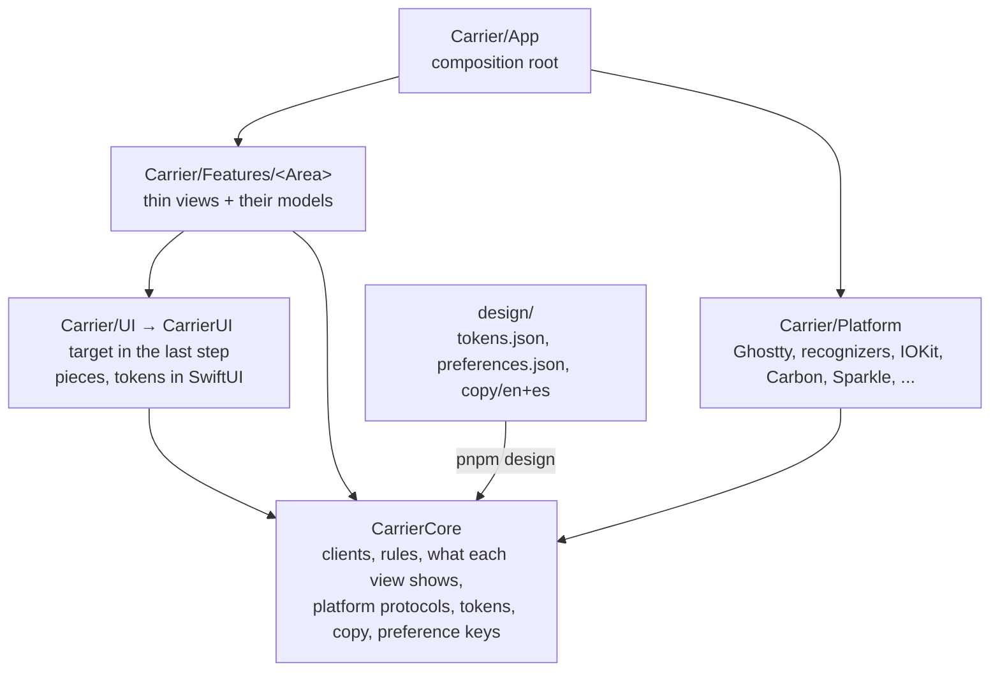
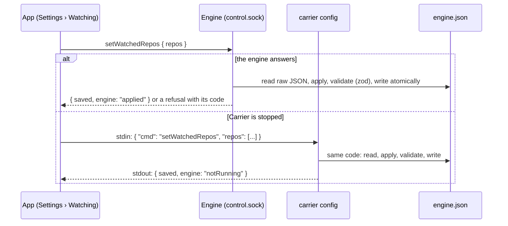
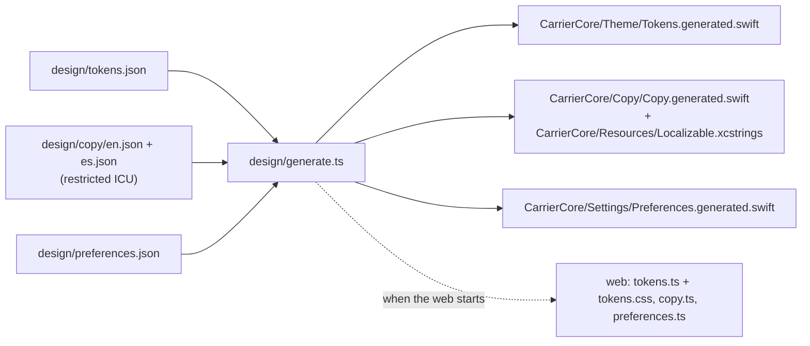
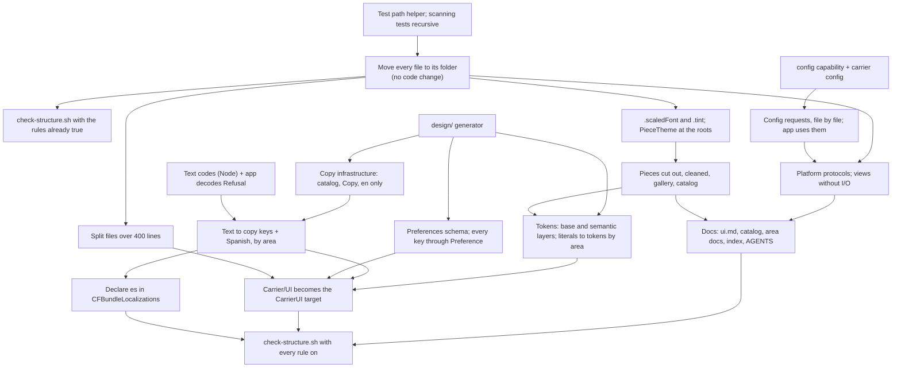

# The macOS app is reorganized as the base a web front-end is built on

Status: spec

## Problem

Carrier reaches only people on a Mac, because the only front-end that does everything is the macOS app.
Diego wants a web front-end next, so Carrier can be used from a browser on Linux, where the engine and the chat host already run (the verify, pack and npm jobs of the release are Linux), and the product also lacks a baseline every product has: it cannot be translated.
The macOS app works well and building it went well; nothing hurts while it is the only front-end.
The cost shows the moment a second front-end has to reproduce it, because what the web would need is kept only in Swift and scattered:

- The app has no structure inside its targets: `Carrier/` is 170 files in one folder (101 views, 23 AppKit bridges, models, services and helpers side by side), and `CarrierCore/` is 193 in another.
- The pieces the app reuses are hidden in the screens that first needed them: `SettingsTabs.swift` (1,494 lines) holds five pages and about 25 pieces that 40 files use; `BehaviorTab.swift` holds the capsule button styles that 33 files use; and the pieces read the app's shared state (`AppTheme`, `TextSize`, `IconAppearance`, `ProviderIdentityStore`) instead of taking values.
- The look is half tokens and half literals: the nine themes are hex values in a Swift `switch`, about a dozen colours live outside them, and the views carry 156 literal radii, 65 literal paddings and 37 `Color(red:)`.
- The words are literals with no localization: about two thousand user-facing texts (254 `Text("...")`, 203 `Label("...")`, 71 `Button("...")`, 57 `Toggle("...")`, help, accessibility labels, alerts, menus, notifications, Settings' search index, the titles enums give, the sentences `CarrierCore` builds), and Node sends the app English it shows whole: about 200 refusals, the doctor's details and fixes, the chat's notices, the preparation steps, the reasons an epic stops, the providers' problems and the usage messages.
- The preferences are read and written from 56 files (208 `@AppStorage`, 49 `UserDefaults`), with about 30 keys declared outside `AppPreferences`.
- The app writes the Carrier folder's config files itself, from about fifteen Swift files that repeat the zod rules; no socket request writes config, and a browser cannot write a file, so a web front-end could not change any setting.
- Some views start processes or touch files (`StartController`, `ModelPicker`, `ProjectsTab`, `WatchingTab`, `AgentsTab`).

Diego also wants, for its own sake, code that is easier to understand, smaller tests and better documentation.

We know it is done, and the web front-end can start, when all of these hold, even if some code could still be better:

- every app area has one folder per layer and one doc;
- no source file is longer than about 400 lines;
- no piece knows a domain type or reads the app's shared state, and no view starts a process or touches a file;
- the design tokens, the copy in English and Spanish and the preferences' schema are generated for Swift and TypeScript from one source, checked by CI, and the app is in Spanish when macOS gives it Spanish;
- every text Node sends a person carries a code;
- every change of a config file is written by Carrier's Node code;
- every piece and every area has tests of what it shows and does, and the docs follow the new tree.

## Solution

The macOS app and the contract around it are reorganized so that what a front-end needs exists once, in a form a second front-end takes as it is, without changing what a person sees or can do.
It has five parts: the contract (text codes, and config written by Node), one source for the look, the words and the preferences (`design/`), the structure of the app (layers, areas, pieces, platform adapters), the docs, and the checks that keep all of it true.
All of it lands while no other change is made to the app, the engine or the chat host; the order of the work is at the end of this section.

[The structure map](../research/macos-app-structure-map.md) is the companion of this spec: the tree folder by folder, every one of the 363 Swift files with its new folder, the pieces hidden in screens, the 34 files over 400 lines, the views that reach the machine, the config the app writes today and the refusals by file.

### 1. The layers and the tree



```
macos/Sources/
  CarrierCore/  Connection/ Lifecycle/ Shell/ Sessions/ Chat/ Epics/ Projects/ Terminal/ Dictation/ Usage/ KeepAwake/ Updates/ Health/ Settings/ Platform/ Theme/ Copy/ Support/ Fixtures/  Resources/
  Carrier/      App/  Features/{Lifecycle,Sessions,Chat,Epics,Projects,Terminal,Dictation,Usage,KeepAwake,Updates,Health,Settings}/  Platform/  UI/{Tokens,Buttons,Fields,Selects,Rows,Cards,Chips,Meters,Feedback,Layout,Modifiers,Icons}/
macos/Tests/    CarrierCoreTests/ and CarrierTests/ with the same folders as the sources; Fixtures/ where it is
design/         tokens.json  preferences.json  copy/en.json  copy/es.json  copy/fixtures.json  generate.ts  generate.test.ts
```

A dependency only points down ([0052](../adr/0052-the-macos-app-is-split-into-three-targets-by-layer-and-each-target-by-area.md)).
`CarrierCore` keeps no SwiftUI or AppKit, as today.
SwiftPM takes subfolders of a target with no change to `Package.swift`, so the move needs none until the `CarrierUI` target; `Resources/` stays at the root of `CarrierCore`, where `Package.swift`, `build-app.sh` and the CI paths name it.
No two files of one target may share a name (Swift refuses it); five names exist in both targets (`BrandLogo`, `EpicView`, `ModelPicker`, `SpeechModelsTable`, `SubagentView`), which is allowed.

Where a file goes is in the structure map; two rules decide the ones whose name does not say:

- A Settings page that changes one area lives in that area (Dictation, Terminal, Sessions, Projects, Keep awake); a page that is Carrier's config or the app as a whole lives under `Features/Settings/` (Agents, Watching, Behavior, Providers, Engine, General, Appearance, Notifications, Keybindings, About).
- Only `Platform/` imports Ghostty, FluidAudio, WhisperKit, Speech, AVFoundation, IOKit, Carbon, ApplicationServices, UserNotifications, Sparkle, MetricKit or ServiceManagement, or calls their symbols; a file that needs one and also draws is split in two.

A file the map put in the wrong folder moves to the right one, and the map is corrected in the same change.
A test file named after no source file (53 of them) goes to the folder of the area it tests.

The tests find their fixtures and the sources by climbing a fixed number of folders from `#filePath` (52 uses in 43 files), and two of them scan a folder without its subfolders (`SettingsIndexDriftTests`, `NoHandSetFontSizeTests`), so a move would break the first kind and let the second pass while scanning nothing.
Before anything moves, each test target gets one helper that finds `Tests/Fixtures`, `Sources` and the repository root from any depth, every `#filePath` climb uses it, the scanning tests walk subfolders and assert a minimum of files scanned (as `ChatHostTests` does), and `IconMotionTests` stops naming `Sources/Carrier/IconController.swift`.

### 2. Platform adapters, and views that do not reach the machine

`CarrierCore/Platform/` declares a protocol for each thing only the platform can do; `Carrier/Platform/` implements it; a model in `Features/` or the core takes the protocol, and its tests take a fake.
Some protocols exist already and move there as they are: `Recognizer`, `BatchTranscriber`, `AudioCapture`, `NotificationCentre`, `NotificationPermissionReader`, `TerminalOpener`, `ModelDownloader`, `TextModelClient`.
The new ones are only those the moves below need: `ProcessRunner` (what `ProcessRun`, `BrewRunner` and `ShellDetector` do), `KeepAwakeAssertion` (IOKit), `GlobalShortcut` (Carbon), `Clipboard`, `Updater` (Sparkle), `AudioPlayer` (AVFoundation) and `AccessibilityTrust` (`AXIsProcessTrusted`).
Five files outside the future `Platform/` use such a framework today: `AboutTab` (Sparkle's `SPUUpdater`), `AudioPlayerView` (`AVAudioPlayer`), `DictationStatusCard` and `GlobalDictationGroup` (ApplicationServices), and `SettingsTabs`, whose `ServiceManagement` import is unused and goes.
No view starts a process, reads or writes a file, or opens a socket; the views that do today move that work as the structure map's table says (`StartController` to `CarrierCore/Lifecycle` through `ProcessRunner`, `ModelPicker` to a model in `CarrierCore/Chat`, the config writes of `ProjectsTab`, `WatchingTab`, `AgentsTab`, `BehaviorTab` and `SettingsWindow` to the requests of §6, the socket of `HealthTab` to `CarrierCore/Connection`).

### 3. Pieces

A piece is cut out of its screen into one file under `Carrier/UI/<kind>/`, cleaned to the nine rules of [0052](../adr/0052-the-macos-app-is-split-into-three-targets-by-layer-and-each-target-by-area.md), and given its catalog entry (§8) and its gallery entry (§4).
The pieces to cut are in the structure map: the 28 piece files of today and the ones hidden in `SettingsTabs`, `BehaviorTab`, `SidebarView`, `SessionRowView`, `NoticeCard`, `DictationTab`, `ChatToolGroupView`, `ConversationView`, `ComposerMenuButton`, `UsageView` and `SliceCardView`.
Cutting them out of their files widens about 162 `private` and `fileprivate` declarations, in `SettingsTabs`, `SheetParts`, `OverviewParts`, `RowParts` and `BehaviorTab` mostly.
A piece used by one area only stays in that area.

What the app's shared state gives a piece reaches it through SwiftUI's `Environment`, set once at each window's root, never by reading a shared instance.
Today the shared instances are `@Observable` singletons refreshed from the user defaults (`TextSize`, `IconAppearance`, `MonospaceStyle`, `ProviderIdentityStore`, `AppTheme`), and the two most used reads are static: `Font.scaled(...)` (421 calls in 83 files) is a static `Font` factory and `Color.themeAccent` (121 uses in 46 files) a static colour, so neither can read the environment.
The change is therefore in two moves:

1. A view modifier `.scaledFont(...)` that reads the text size from the environment, and the accent through SwiftUI's `.tint`, which the `Themed` modifier already sets at the window roots; the pieces move to them, and the rest of the app follows area by area. `Font.scaled` and `Color.themeAccent` go when nothing calls them.
2. `PieceTheme` in the environment for what a piece needs beyond that (the surfaces of the theme for the gallery's light and dark, the icon appearance), set by the `Themed` modifier and at the four `NSHosting*` roots (`SettingsWindow`, `WindowController`, `DictationWidget`, `HoverCard`).

```swift
// CarrierUI/Tokens: what a piece may read from the app beyond .tint and the text size, set at each window's root.
public struct PieceTheme: Equatable, Sendable {
    public var surfaces: ThemeSurfaces
    public var iconWeight: IconWeight
}

// A piece takes values: the area resolves who the account is, the piece draws it.
struct AccountMark: View {
    let initials: String
    let tint: Color
    var body: some View { Text(initials).scaledFont(.caption).foregroundStyle(tint) }
}
```

`PieceTheme` grows only with what the pieces really read today.
Today's `AccountMark` reads `ProviderIdentityStore` itself; after, the area that shows an account (18 places in 9 files read the store) asks it and passes `initials` and `tint`.
`TextSize.shared` read raw (`CommandTextView`, `DictationWidget`, `StatisticsGroup`, `SubagentHeaderView`, `Icons`) and `AppTheme.shared` read raw (`SidebarView`) go the same way.

`Carrier/UI/` becomes the `CarrierUI` target in the last step (§10), when no piece reads the app's state; each piece then needs `public` on its type, its initializer and what the app calls, about four per piece.

### 4. The gallery

Under `--fixture`, a Pieces page draws every piece of `Carrier/UI/` in each state its catalog entry lists, next to the notices that `NoticesGalleryView` already draws.
It is reached the way `NoticesGalleryView` is: a fixture session of its own in `AppFixture/chat-list.json`, which `FixtureServer` lists, and a `shows(_:)` check in `ConversationView` that draws the page instead of the conversation for that id.
The page lives in `Carrier/Features/Settings/` with `NoticesGalleryView`, its data in `CarrierCore/Fixtures/`.
A switch draws the pieces light or dark by passing that scheme's `ThemeSurfaces` in `PieceTheme`, since `AppTheme` follows the window's appearance and not the subtree's colour scheme.
The language is the app's: to see the pieces in Spanish, Carrier Dev is opened again with `-AppleLanguages (es)`; no switch changes it live.
The switches keep their state in the view, never in the preferences: `--fixture` runs on the dev build's real user defaults.
It is for looking at, not a test, and never shows outside `--fixture`.

### 5. Text codes

Every text Node sends a person carries a text code and its parameters beside its English words ([0055](../adr/0055-a-refusal-carries-a-code-and-its-parameters-and-its-english-words-are-the-fallback.md)).

**Refusals.**

```ts
// src/chat/runner.ts
export type TextParams = Record<string, string | number>;
export class ChatRefused extends Error {
  code: string;
  params: TextParams;
  constructor(code: string, message: string, params: TextParams = {}) {
    super(message);
    this.code = code;
    this.params = params;
  }
}
export const textCode = /^[a-z][a-zA-Z]*(\.[a-z][a-zA-Z]*)+$/;
```

```ts
// before
throw new ChatRefused(`This agent has no option "${id}"; it offers: ${options.map((o) => o.id).join(', ')}`);
// after
throw new ChatRefused('session.option.unknown', `This agent has no option "${id}"; it offers: ${offers}`, { option: id, offers });
```

The reply keeps today's shape and adds two keys, so an app that predates the codes reads it as before:

```json
{ "id": 7, "ok": false, "error": "This session is switching to another agent; try again in a moment", "code": "session.switching", "params": {} }
```

- A code is `<area>.<what>`, matched by `textCode`; a parameter is a string or a number, never a sentence, an object or a boolean.
- `code` is the constructor's first argument; `pnpm typecheck` refuses a `ChatRefused` without it, which matters because Node strips the types and would run `new ChatRefused('words')` with the words as the code. The refusals are rewritten file by file (`sessions.ts` 81, `projects.ts` 31, `worktree.ts` 16, `claude.ts` 11, `folder.ts` 10, `workspace.ts` 9, `codex.ts` 7, `names.ts` 5, `account.ts` 3, `usage/service.ts` 2, `mcp/history.ts` 2), and the factories that build many (`ghRefusal`, the clone failure, those in `workspace.ts`, `worktree.ts` and `mcp/history.ts`) and the helpers that compute a reason elsewhere (`invalidReason`, `takenBecause`, the account and usage ones) return a code with it.
- The engine's `ResumeRefused`, `RecoverRefused` and `ReloadRefused` take a code the same way (the first two already carry code-like unions), and so do the fixed errors of both servers: `invalid JSON` (`request.invalidJson`), `invalid request` (`request.invalid`), `line too long` (`request.tooLong`), `internal error` (`request.internal`), `unknown epic` (`epic.unknown`), `unknown file` (`file.unknown`), `unknown execution` (`execution.unknown`), `github unavailable` (`github.unavailable`).
- A config problem (`ReloadRefused`, and the refusals of §6) gives the key path and the kind of problem as parameters (`{ path: 'repos[2]', problem: 'notARepo' }`), so the Watching banner points at the field without its regex.

**The other texts.**
Each field that carries a person's text keeps its words and gains a sibling `code` and `params`: a doctor check's `detail` and `fix` (`src/doctor/doctor.ts`, `fixes.ts`, about 25 details), a chat notice (9 in `sessions.ts`), a preparation step's `detail` (29 `stepEvent` and `failStep`), the reason an epic needs a human (15 `toNeedsHuman`; its kind is already a code), a provider's `problem` (`src/chat/providers.ts`) and a usage `message` (`src/usage`).
What is stored before it is shown stores its code too: a failed preparation step, a clone's `error`, a notice and a cleanup's `skipped.reason` in the chat's events, so a text read back later is still translatable; an event stored before this change has no code and shows its words.
The chat's `health` request already answers codes (`ToolState`) and stays.

**Who reads a text to decide.**
Code that branches on what a text says branches on its code: in the app `Resume.swift` (`ResumeRefusal`'s raw values are the engine's words), `isRepoNotVisible` (`ProjectSheet`), `signInLine` (`ChatConversation`), `WatchingList.refusalBanner`, the doctor checks named by text (`RepoChecks`, `HealthRows`) and the usage messages matched by text (`UsagePage`); in Node `control/epic.ts` (`startsWith('review limit')`) and `orchestration/engine.ts`; in the CLI `status`, `recover` and `restart`.
The chat MCP passes the words to the agents as today, and the CLI prints the words.

**In Swift.**
`ControlError.remote(String)` becomes `ControlError.remote(Refusal)`, with `code: String?`, `params: [String: TextParam]` and `text: String`, decoded in `ControlClient` (its one decoding place) with `code` and `params` optional.
The app's own refusals (about 22 in `ChatHost`, 5 in `ControlRequests`, the copies of Node's in `WorkspaceSources`) get codes of their own, and `FixtureServer`'s `refused()` (27 uses) answers codes like Node.
The app shows `Copy.text(code, params)` when the catalog has the code (copy key `text.<code>`) and the words otherwise.
About 91 reply assertions in the Node tests and 113 `ControlError.remote` expectations in the Swift tests change shape with it.

### 6. Config written by Carrier's Node code

Every write of a config file at the top of the Carrier folder is done by Carrier's Node code, in the module that owns that file's schema ([0053](../adr/0053-a-carrier-config-file-has-one-owner-process-and-a-front-end-writes-it-through-that-process.md)).
A front-end asks for one change at a time:



- When the process that reads the file answers on its socket (the engine for `engine.json`; the chat host for `chat.json`, `projects.json` and `providers.json`), the request goes there.
- When it does not, the app runs `carrier config` (the `carrier` it starts Carrier with) with the same request, without its `id`, as one line of JSON on standard input; the command forwards it to the socket if one answers by then, and otherwise writes the file itself with the same code, and prints the reply as one line of JSON; it exits 0 when it saved, 1 when it refused, 2 when it could not run.
- `carrier init` writes through the same code.
- The writing code edits the file's raw JSON, not the loaded config (`loadConfig` mixes in the defaults): it reads the file again just before writing, applies the change, validates the whole result with the file's strict schema, writes a temporary file and renames it, and answers the saved part of the file.
- For `engine.json` and `providers.json` the reply also says what the engine did: `engine: "applied"`, `engine: "refused"` with the engine's reason as a text code, or `engine: "notRunning"`; the pages keep showing it as they show `reloadWords` today.
- A page that saves on each keystroke (Behavior) keeps its pause before it sends the change.
- Saving a project becomes asynchronous where `ProjectsModel` writes synchronously today; removing a project deletes the app's copy of its icon after the reply says it was removed.
- Removing an account checks that no role of `engine.json` and no agent of `chat.json` names it (`accountUses` today), so the host reads `engine.json` for that check just before it writes `providers.json`.
- A file broken by hand is fixed by hand: the engine and the host refuse to start on it, as today.

The requests replace today's Swift writes one to one; each takes what the Swift function it replaces takes, and refuses what that function refused, with the same words, now with a code.

| Owner | Request | Replaces (Swift, `CarrierCore/` unless noted) |
| --- | --- | --- |
| chat host | `addProject { folder }` | `applyingProjectAdd` |
| chat host | `removeProject { path }` | `applyingProjectRemoval` |
| chat host | `editProject { path, key, value }` | `applyingProjectEdit`, `applyingProjectObjectEdit` |
| chat host | `moveProject { path, folder }` | `applyingProjectLocation` |
| chat host | `editProjectIcon { path, changes }` | `applyingProjectIconEdit` |
| chat host | `editProjectDefaults { path, changes }` | `applyingProjectDefaultsEdit` |
| chat host | `editProjectTags { path, add, remove }` | `applyingProjectTagsEdit` (its `transform` becomes the two lists) |
| chat host | `setProjectActions { path, actions }` | `applyingProjectActions` |
| chat host | `setProjectsFolder { folder }` | `applyingProjectsFolder` with `writeCurrentChatConfig` |
| chat host | `editChatSettings { changes }` | the `chat.json` write of `Carrier/SessionsTab.swift` |
| chat host | `setAccounts { accounts }` | `applyingAccounts` (`ProvidersPage`) |
| chat host | `addAccount { account }` | `applyingNewAccount` (`ProvidersPage`) |
| chat host | `editAccount { name, changes }` | `ProvidersEdit.applyingEdit` (`ProvidersPage`, `Carrier/ProvidersEditor.swift`) |
| chat host | `removeAccount { name }` | `applyingRemoval` (`ProvidersPage`), with the `accountUses` check |
| chat host | `setTextGenerator { choice }` | `applyingTextGenerator` |
| engine | `setWatchedRepos { repos }` | the `saveConfig` of `Carrier/WatchingTab.swift` and of `ProjectWatch` (`NewSession` watches a project through it) |
| engine | `editBehavior { changes }` | the `saveConfig` of `Carrier/BehaviorTab.swift` |
| engine | `editRole { role, changes }` | `saveGlobalRole` |
| engine | `editRepoRole { repo, role, fields }` | `saveRepoRole` (`fields: null` removes the override) |
| engine | `editPersona { role, name, prompt }` | `saveGlobalPersona` |
| engine | `editFailover { role, first, second }` | `saveGlobalFailover` |
| engine | `setLeadReviewer { draft }` | `turnLeadReviewerOn`, `turnLeadReviewerOff` (`draft: null`) |
| engine | `setOrchestratorProfile { name }` | `applyingOrchestratorProfile` (`EngineIdentity`) |

A request in full, as the server's union holds it:

```ts
const folderPath = z.string().min(1).max(4096);
z.strictObject({ id, cmd: z.literal('moveProject'), path: folderPath, folder: folderPath }),
```

All the requests of one socket are behind one capability, `config`, as the `projects` capability already covers several requests; that keeps the hello lists, `ControlClient.Capability`, `FixtureServer`'s lists and `capabilities.json` from being edited by every request.
The app sends them only when the hello lists `config`, and uses `carrier config` otherwise; the app, the engine and the chat host are released together, so the app keeps no write of its own to fall back on.
Each request still follows the rest of the checklist in [`src/control/AGENTS.md`](../../src/control/AGENTS.md#adding-a-request-to-a-socket) (schema, handler, fakes, golden reply, Swift request and reply, `FixtureServer` handler, docs).

Once the app uses the requests, the Swift writers go: `saveConfig`, `writeCurrentConfig`, `writeCurrentChatConfig`, `ProvidersFile.write` and the `applying...` functions, with their tests (`ProvidersFileTests`, `RepoRoleSaveTests`, `ProjectsListTests`, `ProjectsFileTests`, `SessionAgesTests`, `LeadReviewerSwitchTests` and others lose their writer cases).
What the app still reads, and the checks its forms run while the person types, stay: `readProjects` and the `parse` and `problems` behind it, `EngineConfig(json:)` and `.problems`, `ProvidersEdit.draftProblems` and `nameProblem`, `repoProblem` and `reposProblem`, `RoleFields.problems`.
`ContractTests` read the side the app reads today; they gain the side it sends: each request the app builds, as its golden says, is accepted by Node.
`FixtureServer` keeps writing a scratch Carrier folder under `--fixture`, and answers the new requests like the real ones.

### 7. One source for the look, the words and the preferences

`design/` holds the sources, and `design/generate.ts`, a TypeScript script run by Node with no dependency, writes the code of each front-end ([0054](../adr/0054-the-look-the-words-and-the-apps-preferences-have-one-neutral-source-generated-for-each-front-end.md)).
`pnpm design` writes the files; `pnpm design:check` writes them to a temporary folder and fails when they differ from the committed ones, the way the Migrations job checks `pnpm db:generate` for drift.
The generated files start with `// Generated by design/generate.ts from design/; do not edit.` and are committed.
`vitest.config.ts` includes `design/**/*.test.ts`, and `tsconfig.json` includes `design`.
The prototype of the copy generator (about 250 lines, no dependency) is the starting point.



The TypeScript outputs for the web are not written until the web exists; the generator has them and its tests check them, so they are ready.

**Tokens.**
`design/tokens.json` has a base layer and a semantic layer.
The base layer holds the nine themes in light and dark (the hex values of `Theme.swift` today, moved as they are), the accent presets, the radii, the spacing, the text sizes, the opacities and the durations.
The semantic layer names what a colour is for and points at the base: the status colours, the kinds of tool call (`ChatToolGroupView`), attention (`ChatApprovalView`), the slow call, the accent's glass and selected row (`ToolbarPillButton`), the light and dark pairs of `SessionRowView` and `SessionPeekView`.
The scales are taken from the literals the views use today, so that replacing a literal by a token changes nothing or moves a value by one point: the radii in use are 8 (54 times), 12 (30), 16 (19), 10 (17), 9 (12), 6 (7), 14 and 3 (4 each), and the paddings 12, 14, 8, 20 and 5.

```json
{
  "theme": {
    "carrier": { "dark": { "window": "#1c1c1e", "sidebar": "#2f2f33", "accent": null }, "light": { "window": "#f2f2f7", "sidebar": "#dcdce2", "accent": null } },
    "ocean":   { "dark": { "window": "#0f1b24", "sidebar": "#18304a", "accent": "#32ade6" }, "light": { "window": "#eaf3fa", "sidebar": "#cfe3f2", "accent": "#0a7fc0" } }
  },
  "radius": { "small": 6, "control": 8, "card": 12, "panel": 16 },
  "space": { "xs": 4, "sm": 8, "md": 12, "lg": 16, "xl": 20 },
  "duration": { "quick": 0.15, "standard": 0.25 }
}
```

The names and the exact scale are chosen when the literals are replaced, area by area; a literal that matches no token is either the nearest token or, when the difference shows, a new token with a reason in `docs/ui.md`.
Radii, paddings, `spacing:` and colours become tokens; frame sizes and opacities of one view stay literals.
`Theme.swift` keeps its API (`Theme`, `RGBA`, `ThemeSurfaces`) and reads the generated table instead of its `switch`; the `.accentColor` uses that skip the theme (`ProjectsTab`, `ProvidersEditor`) read the theme's accent.

**Preferences.**
`design/preferences.json` holds every key of the app's preferences with its type, its default and the Settings page whose Reset clears it: the keys `AppPreferences` declares and the ones declared elsewhere today (13 in `Sidebar.swift`, 12 in `NotificationsTab.swift`, and those of `EpicMenu`, `StartCarrier`, `TypeScale`, `IconSets`, `IconWeight`, `InspectorTabs`, `Shortcuts`, `SessionSeen`, `SetupDetection`, `HostReplacement`).

```json
{
  "appearance.density": { "values": ["compact", "comfortable"], "default": "comfortable", "page": "appearance" },
  "menu.animate": { "type": "bool", "default": true, "page": "general" },
  "appearance.textSize": { "type": "int", "min": 90, "max": 130, "default": 100, "page": "appearance" },
  "terminal.font.size": { "type": "double", "optional": true, "page": "terminal" }
}
```

The types are `bool`, `int`, `double`, `string` and an enum's `values`, each of them `optional` when no value means "as the system or the theme says" (`terminal.font.size`, the accent); the generated `reset(page)` replaces the hand-written lists of `AppPreferences.keys(of:)` and `terminalKeys`.
Keys that hold state rather than a choice stay out: the per-session `chat.options.<id>`, `chat.commands.<id>` and `chat.agent.<id>`, the last Settings page, Sparkle's `SU*` keys.
Where today's readers disagree, the schema settles it: a view that stores an enum's raw value reads the enum (`SettingsTabs`, `KeepAwakeTab`, the terminal `*Raw` values); `dictation.cleanup.enabled` gets its default (`false`, what the views assume); `menu.showEpics` loses its separate `register(defaults:)` in `AppDelegate`.
The keys' names do not change, so a person's saved preferences survive.

It generates a typed key per preference, and the views read and write through it:

```swift
// CarrierCore/Settings/Preferences.generated.swift (shape)
public struct PreferenceKey<Value: Sendable>: Sendable {
    public let name: String
    public let defaultValue: Value
    public init(_ name: String, default defaultValue: Value) { self.name = name; self.defaultValue = defaultValue }
}
public enum Preference {
    public static let density = PreferenceKey("appearance.density", default: Density.comfortable)
    public static let animates = PreferenceKey("menu.animate", default: true)
    public static let textSize = PreferenceKey("appearance.textSize", default: 100)
}

// Carrier: the one door the views use.
extension AppStorage {
    public init(_ key: PreferenceKey<Value>, store: UserDefaults? = nil) where Value == Bool { self.init(wrappedValue: key.defaultValue, key.name, store: store) }
    public init(_ key: PreferenceKey<Value>, store: UserDefaults? = nil) where Value == Int { self.init(wrappedValue: key.defaultValue, key.name, store: store) }
    public init(_ key: PreferenceKey<Value>, store: UserDefaults? = nil) where Value: RawRepresentable, Value.RawValue == String { self.init(wrappedValue: key.defaultValue, key.name, store: store) }
}

// A view, instead of @AppStorage(AppPreferences.densityKey) private var density = AppPreferences.defaultDensity
@AppStorage(Preference.density) private var density
```

The snippet was compiled and run on 2026-11-24: an unset key gives the default, a stored one its value, and a stored value that is not one of the enum's falls back to the default.
`Double` gets the same initializer, and an optional preference a pair of `AppPreferences` accessors (read, and set or remove), since `@AppStorage` has no optional `Double`.
`AppPreferences` keeps its typed accessors for the code that is not a view, reading the same generated keys; code that takes `defaults: UserDefaults = .standard` for its tests keeps taking it.

**Copy.**
`design/copy/en.json` and `es.json` hold every user-facing text by copy key, in the restricted ICU of [0054](../adr/0054-the-look-the-words-and-the-apps-preferences-have-one-neutral-source-generated-for-each-front-end.md) (`{name}`, `{name, number}`, `plural` with `=0` and the CLDR categories, `select`, one level of nesting): every `Text`, `Label`, `Button`, `Toggle` and field prompt, help, accessibility label, alert, menu item (`MainMenu` has 72, `StatusMenuGroups` 17), notification, Settings' search index (143 in `SettingsIndex`), the titles enums give (`case ...: "Sentence"`, `rawValue.capitalized`) and the sentences `CarrierCore` builds; about two thousand in all.
The generator writes `CarrierCore/Resources/Localizable.xcstrings` and `Copy.generated.swift`, a typed function per key:

```json
{ "epicsWaiting": "{count, plural, one {# epic waiting} other {# epics waiting}}" }
```

```swift
public enum Copy {
    /// One language's catalog, for tests; the app passes none and gets the language macOS gives it.
    public static func bundle(_ language: String) -> Bundle {
        carrierResources.path(forResource: language, ofType: "lproj").flatMap(Bundle.init(path:)) ?? carrierResources
    }
    public static func epicsWaiting(count: Int, bundle: Bundle? = nil, locale: Locale = .current) -> String {
        String(localized: "epicsWaiting \(count)", bundle: bundle ?? carrierResources, locale: locale)
    }
}

Text(Copy.epicsWaiting(count: waiting))   // instead of Text("\(waiting) epics waiting")
```

`Copy` reads `carrierResources` (`ResourceBundle.swift`), never `Bundle.module`: SwiftPM's `Bundle.module` looks next to the `.app` and traps in the packaged app.
`bundle` is optional rather than a default value, because a public function cannot use an internal value as a default; with `Copy.bundle("es")` and `Locale(identifier: "es_AR")` a test renders "1.234 epics en espera" with no app around it (prototyped on 2026-11-24 with `Bundle.module`, which the tests use, as `carrierResources` falls back to it).
The key the catalog holds carries the format of each argument (`epicsWaiting %lld`), each plural is a substitution, each select branch is a key of its own behind a generated enum, and values use positional specifiers, as prototype 2 ran.

What finds something by its English title finds it by a stable identifier instead: `MainMenu` finds the Services and other system menus by their `NSApp` role, not `item(withTitle:)`; `SettingsIndex` makes its anchors and its drift test from page and row identifiers, not from titles; the last Settings page is saved by its identifier.
Dates, times and relative times are formatted for the person's locale: `TimeText`'s "now", "m" and "Yesterday" become copy keys, and its `en_US_POSIX` formatters (and those of `SessionAges`, `CarrierBox`, `UsageConsumption`, `DictationRecords`) use the current locale.
A sentence the core builds from data becomes a function returning its text through `Copy`, and a sentence built from pieces with `+=` becomes one key.
The tests that compare English words (about 699 expectations in 104 files) render with `Copy.bundle("en")` and an English locale.

`Package.swift` gets `defaultLocalization: "en"` and the catalog as a processed resource of `CarrierCore`, beside its copied ones.
`build-app.sh` writes `CFBundleLocalizations` into the `Info.plist`: with `en` alone while the translation is in progress, and with `en` and `es` in the slice that finishes it, once `design:check` reports no key without Spanish words; declaring Spanish turns macOS's own texts Spanish at once, so it waits for the app's.
`macos/scripts/check-app.sh` asserts the key and finds the `lproj` folders inside `Carrier_CarrierCore.bundle` with `find`, since the bundle's layout nests `Contents/Resources` with Swift 6.4 and not with 6.3.
`design/copy/fixtures.json` lists cases (a key, its arguments, the language and region, the expected text) that the generator's tests run on the TypeScript side and a `CopyTests` suite runs on the Swift side, so both say the same.
English is the source; a key missing in Spanish, or with other arguments, fails the generator.
The translations are the one exception to "all repo content is in English", and `AGENTS.md` says so.

### 8. Docs

- `docs/macos-ui.md` becomes `docs/ui.md`: the rules of the look for every front-end, the nine rules of a piece with an example each, and what only macOS does in a section of its own.
- `docs/ui.md` has the catalog of the pieces, one entry per piece:

  ```markdown
  ### NoticeCard
  Kind: Cards · File: `macos/Sources/Carrier/UI/Cards/NoticeCard.swift` · Web: `<NoticeCard>`
  Takes: `kind` (info, warning, error), `title`, `detail`, `actions` (title and closure, at most two).
  States: each kind; with and without detail; with zero, one and two actions; hover on an action; disabled action.
  Use for: a notice about the whole page or conversation. Not for: a problem of one field (that is `ProblemLine`).
  ```

- `docs/macos/` follows the areas: `chat.md` (from `sessions.md` § Conversation and § Context and limits), `epics.md` (from `app-shell.md` § Resume card, § The pipeline, § Slices and findings, § Agent output, and `sessions.md` § The epic's Agent output) and `projects.md` (from the parts of `new-session.md` and `settings.md` § Projects page that describe projects) are new; the sections they take are moved, not rewritten, and their old places link to them.
- The docs name Swift files by their bare name about 181 times in 27 files, and by their full path 14 times (`src/control/AGENTS.md`, `src/config/AGENTS.md`); each mention is updated to the file's new place in the change that moves it, and the two real links (`docs/specs/usage-and-limits.md`, `docs/specs/session-titles-from-a-text-generator.md`) too.
- `docs/README.md` (new) is the index: every doc, grouped by area, with a line each.
- `macos/AGENTS.md` follows the new tree, area by area; it is at 9,993 of the 10,000 bytes `agent-context.sh` allows a folder's `AGENTS.md`, so it moves its per-area detail to the area docs it already points at rather than growing.
- `CONTRIBUTING.md`'s repository structure shows `design/`; `AGENTS.md` names the translations as the one exception to English and points at `docs/ui.md`; `src/control/AGENTS.md` and `docs/specs/chat-host.md` list the text codes, the new requests and `carrier config`; `docs/configuration.md` and `docs/cli.md` say who writes each file and how.
- Of what a view does with the machine, only the global dictation's paste goes behind a protocol; the views that copy a text to the pasteboard keep doing it (Diego, 2026-11-24).
- A piece "knows no domain type" means it names no type declared under the area folders of `CarrierCore`; shell and theme types such as `AppIcon` and `IconSet` are allowed.
- The terminal needs no surface protocol: its Ghostty files already live in `Platform/`, and the part left to move is the terminal opener.
- The last Settings page is saved by its identifier; a value stored before (the English title) still opens its page, and an unknown one opens General.
- The texts of the fixture galleries are copy keys too; the rule that finds literal texts has no exception for them.
- The code of an epic's stop reason survives an engine restart, so the engine's database gets a column for it and a migration.
- `*.generated.swift` is left out of the 400-line rule, with its reason written in the rule's list of exceptions.
- `carrier config` prints the reply the socket would send, without its `id`, and exits with 2 when its standard input is not JSON.
- The glossary already has the new terms (front-end, app area, piece, platform adapter, design token, copy key, text code, config owner).

### 9. The checks that keep it true

`macos/scripts/check-structure.sh`, run in the app's CI job after `test-ci.sh`, fails when any of these is broken, and prints the file and line.
Each rule names what it ignores, because a plain grep finds false alarms:

- A Swift file under `macos/Sources` is longer than 400 lines; an explicit list of exceptions, each with its reason, is allowed and starts empty.
- Two Swift files of one target share a name.
- A file under `Carrier/UI/` names a type declared at the top level of a file under `Carrier/Features/`, `Carrier/App/` or `Carrier/Platform/`, comments stripped; nested types (`Face`, `Entry`, `Coordinator`) do not count. Until `CarrierUI` is a target, when the compiler takes over.
- A file outside `Carrier/Platform/` imports a framework of §1's list, or calls a symbol with its prefix (`AX`, `SPU`, `AVAudio`, `IOPM`, `UN`, `MX`, `CGEvent`), since AppKit brings ApplicationServices in without an import.
- A file under `Carrier/` outside `UI/Tokens/` has a literal number in `cornerRadius:`, `.padding(` (with or without an edge), `spacing:`, or a `Color(red:`, `NSColor(red:`, `Color(hue:` or `Color(white:`.
- A user-facing string literal is passed to `Text`, `Label`, `Button`, `Toggle`, `TextField`, `.help`, `.accessibilityLabel`, an alert or a `title:` label, the call possibly over several lines; empty strings, strings of spaces or punctuation only, and strings made only of interpolations are ignored.
- `UserDefaults.standard`, or `forKey: "` with a literal key, appears outside `CarrierCore/Settings/`; injected `defaults: UserDefaults` parameters and `didChangeNotification` observers are allowed.
- A file under `Carrier/UI/`, outside `Tokens/` and `Modifiers/`, declares a type that no entry of the pieces gallery names.

`pnpm design:check` runs in the engine's CI job.
Each step leaves `pnpm typecheck && pnpm test` and `swift test` green; the number of Swift tests never goes down, and a test moves with its file.
With no tests of rendered views, a step that touches a view is checked by opening Carrier Dev (`./build-app.sh`, no version) under `--fixture`, going through the areas it touched and the gallery, light and dark, and again with `-AppleLanguages (es)` once Spanish is declared, as the `macos-ui-change` skill says.

### 10. Order of the work

The contract work in Node and the `design/` generator do not touch the app's files, and run beside the move.
On the app side, the tests learn to find their files from any depth first, then every file moves, so every later change lands in the new tree.



Each rule of `check-structure.sh` is turned on by the step that makes it true, so CI holds what each step reached.
The pure move changes only files under `macos/Sources` and `macos/Tests`, so it carries the `no-changelog` label (the Changelog job asks for a line otherwise), and it runs the `_macos.yml` workflow by hand (`workflow_dispatch`), since a sources-only change does not build the bundle.

## Scope

1. The Swift tests find their fixtures, the sources and the repository root from any folder depth, and the tests that scan a folder walk its subfolders and fail when they scan fewer files than a minimum.
2. Every Swift file is in its folder of the new tree, with no code changed by the move, and the tests mirror it.
3. `check-structure.sh` runs in the app's CI job, starting with the rules the tree already meets.
4. A chat host refusal carries a text code and its parameters beside its English words; every `ChatRefused` in `src/` has a code that matches `textCode`.
5. An engine refusal (`ResumeRefused`, `RecoverRefused`, `ReloadRefused`) and every fixed error of both sockets carry a code; a config problem carries its key path and kind as parameters.
6. A doctor check's detail and fix, a chat notice, a preparation step's detail, the reason an epic needs a human, a provider's problem and a usage message carry a code and parameters; the ones stored in the chat's events keep their code when read back.
7. The app decodes `code` and `params`, shows the copy of a known code in the person's language and the English words for an unknown one, and decides by code wherever it decided by words (`Resume`, `isRepoNotVisible`, `signInLine`, the Watching banner, the doctor's and usage's checks); the CLI decides by code too.
8. Every config request of a socket is behind its `config` capability, and `carrier config` takes any of them, forwarding to the owner when it answers and writing the file with the same code when it does not.
9. Every change the app makes to `projects.json` goes through the chat host or `carrier config`, and the app writes the file no more.
10. Every change the app makes to `providers.json` (set, add, edit and remove an account, the text generator) goes through the chat host or `carrier config`, and the reply says what the engine did with it.
11. Every change the app makes to `chat.json` goes through the chat host or `carrier config`.
12. Every change the app makes to `engine.json` (watched repos, behavior, roles, repo roles, persona, failover, lead reviewer, orchestrator profile) goes through the engine or `carrier config`, works while Carrier is stopped, and the reply says whether the engine applied it.
13. `carrier init` writes `engine.json` and `providers.json` through the same code.
14. The Swift code that only served writing config is gone; the checks the forms run while typing stay; `ContractTests` check that what the app sends is what Node accepts.
15. `pnpm design` writes the generated files from `design/`, and `pnpm design:check` fails in CI when a committed file differs.
16. The nine themes, the accent presets and the semantic colours come from `design/tokens.json`, and every theme looks as it does today.
17. Every preference, wherever it is declared today, is in `design/preferences.json` and read and written through a generated key; every default and every saved value of today is kept, and each page's Reset clears the keys the schema gives it.
18. The copy catalog is built by `swift build` and `build-app.sh` and read through `carrierResources`; the app shows English, and a test renders any key in Spanish.
19. A copy key renders the same text in Swift and in TypeScript for every case of `design/copy/fixtures.json`, in en-US, es-ES and es-AR.
20. Each thing only macOS can do is behind a protocol of `CarrierCore/Platform/`, implemented in `Carrier/Platform/`, and no view starts a process, touches a file or opens a socket.
21. Pieces read the text size through `.scaledFont` and the accent through `.tint`, and what else they need from the app through `PieceTheme`; `Font.scaled`, `Color.themeAccent` and the raw reads of the shared instances are gone.
22. Every piece used by two or more areas is one file under `Carrier/UI/`, follows the nine rules of a piece, and takes values instead of reading the app's state.
23. Under `--fixture`, the Pieces page draws every piece in each of its states, light and dark, in the language the app was opened in.
24. No Swift file under `macos/Sources` is longer than about 400 lines.
25. No view has a literal radius, padding, spacing or colour; each is a token.
26. No view or core sentence has a literal user-facing text, menus, Settings' search, notifications and the titles enums give included; each is a copy key, in English and Spanish, and dates and times follow the person's locale.
27. Nothing finds a menu, a Settings row or the last Settings page by its English title.
28. Every text code has a copy key in English and Spanish.
29. The app declares Spanish in `CFBundleLocalizations`, and is in Spanish when macOS gives it Spanish.
30. `Carrier/UI/` is the `CarrierUI` target, and a piece that names a type of an area does not compile.
31. `docs/ui.md` holds the rules of the look and the catalog of every piece.
32. Every app area has its doc under `docs/macos/`, `docs/README.md` indexes every doc by area, and every mention of a Swift file in the docs names its new place.
33. `AGENTS.md`, `macos/AGENTS.md` (within its byte budget), `CONTRIBUTING.md`, `src/control/AGENTS.md`, `docs/specs/chat-host.md`, `docs/configuration.md` and `docs/cli.md` follow the new tree, the codes, the requests, `carrier config` and who writes each file.
34. `check-structure.sh` runs in CI with every rule of §9 on, and passes.

## Decisions

The architecture is in [0052](../adr/0052-the-macos-app-is-split-into-three-targets-by-layer-and-each-target-by-area.md) (layers, areas, the rules of a piece, `CarrierUI` as a folder first and a target last), [0053](../adr/0053-a-carrier-config-file-has-one-owner-process-and-a-front-end-writes-it-through-that-process.md) (config written only by Node, through the owner or `carrier config`), [0054](../adr/0054-the-look-the-words-and-the-apps-preferences-have-one-neutral-source-generated-for-each-front-end.md) (`design/`, the restricted ICU, the catalog, Spanish declared last) and [0055](../adr/0055-a-refusal-carries-a-code-and-its-parameters-and-its-english-words-are-the-fallback.md) (text codes); this section does not repeat them.

Implementation calls:

- The generator is `design/generate.ts`, next to its sources, not under `src/`, because `src/` is what is published to npm and the generator is not part of Carrier.
- The config requests are flat commands, one per change, named like today's (`removeProjectWorktree`, `cloneProject`), behind one `config` capability per socket.
- A request takes what the Swift function it replaces takes, and refuses what it refused, with the same words, now with a code.
- `carrier config` reads one request on standard input and prints one reply, so the app needs no new way of talking to Node beyond starting `carrier`, which it already does.
- No compatibility path for an older host or engine: the three are released together (Diego, 2026-11-24), and the Swift writers are deleted with no fallback.
- The pure move is one change with no code edited, so the review is a list of renames; `git` shows each as a rename.
- `PieceTheme` holds only what pieces read today beyond `.tint` and the text size; it does not become a general theme object.
- The token scale comes from the literals in use; tokens are named when they replace literals, not upfront.
- The TypeScript outputs for the web are generated and tested, not written to a web folder, until the web exists.
- The gallery is a fixture session, like `NoticesGalleryView`, so it costs no menu item and never ships to a person; its language is the app's, set by relaunching (Diego, 2026-11-24).
- Spanish is declared in the `Info.plist` only once every key has its Spanish words (Diego, 2026-11-24).
- The rules of `check-structure.sh` are greps and line counts with the exclusions of §9, not a Swift parser: they are cheap, and a false alarm is fixed by renaming or by the rule's exclusion list, not by a smarter tool.

Testing seams, by story:

| Story | Seam | What the test drives and observes |
| --- | --- | --- |
| 1 | the tests themselves | the helper finds `Tests/Fixtures` from a test file two folders deeper than today; `SettingsIndexDriftTests` and `NoHandSetFontSizeTests` fail when they scan fewer files than their minimum |
| 2 | `swift build`, `swift test` | the same tests pass with the same count; no other test |
| 3, 24, 25, 34 | no unit test: `check-structure.sh` in CI is the test | |
| 4 | `src/chat/server.test.ts`, its refusal tables | a refused request answers `error`, `code` and `params`; the codes thrown in the server tests all match `textCode` |
| 4, 5, 6 | a golden list, `macos/Tests/Fixtures/text-codes.json`, written by `UPDATE_FIXTURES=1 pnpm test` | every code with an example of its params; it is the list the app's copy keys are checked against |
| 5 | `src/control/server.test.ts`, its refusal tables | each engine refusal and each fixed error answers its code; a `ReloadRefused` for a bad repo answers its `path` and `problem` |
| 6 | the tests of `src/doctor`, `src/chat/sessions.test.ts`, `src/chat/providers` and `src/usage` | each such text has its code and params; a preparation step that failed, read back from a scratch chat database, still has its code |
| 7 | `ControlClientTests`, and the tests of `Resume`, `ProjectSheet`, `ChatConversation`, `WatchingList`, `RepoChecks`, `HealthRows`, `UsagePage` (CarrierCoreTests) | a reply with a code throws `ControlError.remote` with it; one without, as before, throws it with the words; each decision follows the code, with words that differ from today's |
| 7 | the CLI's tests (`status`, `recover`, `restart`) | the CLI's words come from the code |
| 7, 28 | `ContractTests` | every code in `text-codes.json` has `text.<code>` in the English and Spanish catalogs |
| 8, 13 | the tests of the config writing module and of `carrier config` (`src/terminal/cli/commands`) | with a scratch Carrier folder and no socket, a request writes the file and prints the reply; with a fake owner answering, it forwards and writes nothing; a refused change leaves the file as it was; `carrier init` writes through it |
| 9-12 | `src/chat/server.test.ts`, `src/control/server.test.ts` and the writing module's tests (`src/config/projects.test.ts` and its siblings) | each request: the file after it, its keys as the person wrote them, a value the schema refuses refused with its code, the reply with `engine` where it applies; the golden reply in `macos/Tests/Fixtures` |
| 9-12 | `ChatHostTests`, `ControlRequestsTests`, `FixtureServerTests` | each request is encoded as its golden says, sent to the socket when the hello lists `config` and to `carrier config` (through `ProcessRunner`) otherwise, and answered by the fixture server |
| 14 | `ContractTests` | each request the app builds is accepted by Node's schema; the writer tests go with the writers |
| 15, 19 | `design/generate.test.ts` (vitest) | a table of sources the subset accepts and refuses, with the error; the generated Swift and TypeScript for a small source, as inline snapshots; the TypeScript side of `fixtures.json` |
| 16 | `ThemeTests` (CarrierCoreTests, existing) | every theme in light and dark gives the same `ThemeSurfaces` as today's `switch`, value for value; each semantic colour resolves to today's value |
| 17 | `AppPreferencesTests` (CarrierCoreTests, existing), with a scratch `UserDefaults` suite | every key has today's name and default; a stored value is read back; a stored value that is not valid gives the default; `reset(page)` clears exactly the keys of today's lists |
| 18, 19 | `CopyTests` (CarrierCoreTests, new), reading `design/copy/fixtures.json` | each case through `Copy` with `Copy.bundle(language)` and the case's locale gives the expected text |
| 18, 29 | `macos/scripts/check-app.sh` | both builds' `Info.plist` has `CFBundleLocalizations` (`en`, then `en` and `es`), and the bundle holds `en.lproj` (and `es.lproj`) |
| 20 | the tests of the models that take a platform protocol, with a fake of it, as `FixtureRecognizerTests` does today | what the model asks the platform for, and what it does with the answer |
| 21, 22, 26 | the pure function of each piece and each area in CarrierCoreTests, as `SliceCardTests` and `FindingsCardTests` do | the values a piece or a screen shows for a given input; English words are asserted with `Copy.bundle("en")` |
| 23 | no unit test: the gallery is looked at, and `check-structure.sh` checks that every piece has its entry | |
| 26 | the tests of `TimeText` and the other formatters (CarrierCoreTests) | a time renders for `en_US` and for `es_AR` |
| 27 | `MainMenu`'s and `SettingsIndex`'s tests (`SettingsIndexDriftTests`) | the anchors and the drift test work from identifiers; the menus are found with the app in Spanish |
| 30 | `swift build` | the target compiles; the boundary rule of `check-structure.sh` is removed in the same change |
| 31-33 | no tests: docs; `.github/scripts/agent-context.sh` stays green | |

## Out of scope

The web front-end itself, and any bridge between a browser and the sockets.
Windows, and reaching an engine on another machine.
Keeping a person's preferences in one place across front-ends.
Building `CarrierCore` on Linux.
Reorganizing the folders of `src/`; in Node only the text codes, the config requests and `carrier config` change.
Fixing bugs or performance, including the audit's B01-B07 and R01-R06; they are found again on the new tree afterwards.
Tests of rendered views (snapshots, view inspection).
Changing the gallery's language without relaunching the app.
Translating the texts stored before this change, which have no code and keep their words.
Any new feature, and any change of the look beyond what tokens round.
Languages other than English and Spanish.
